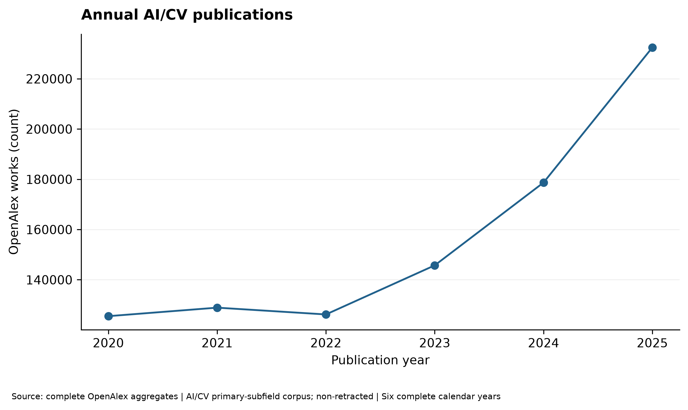
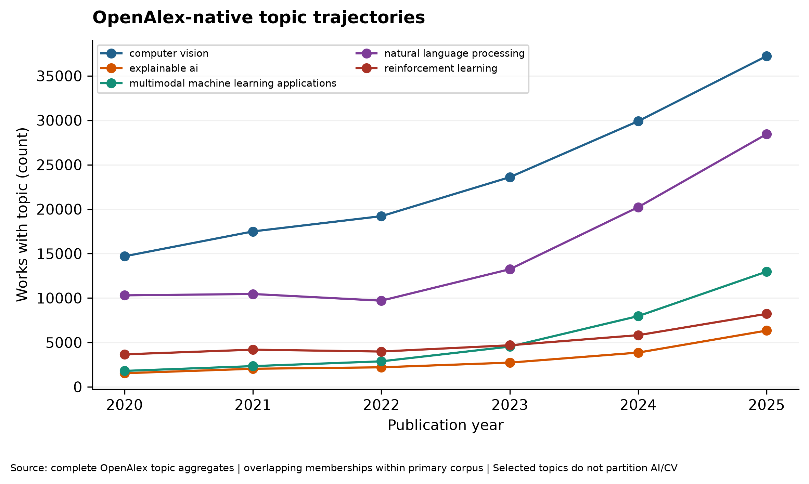
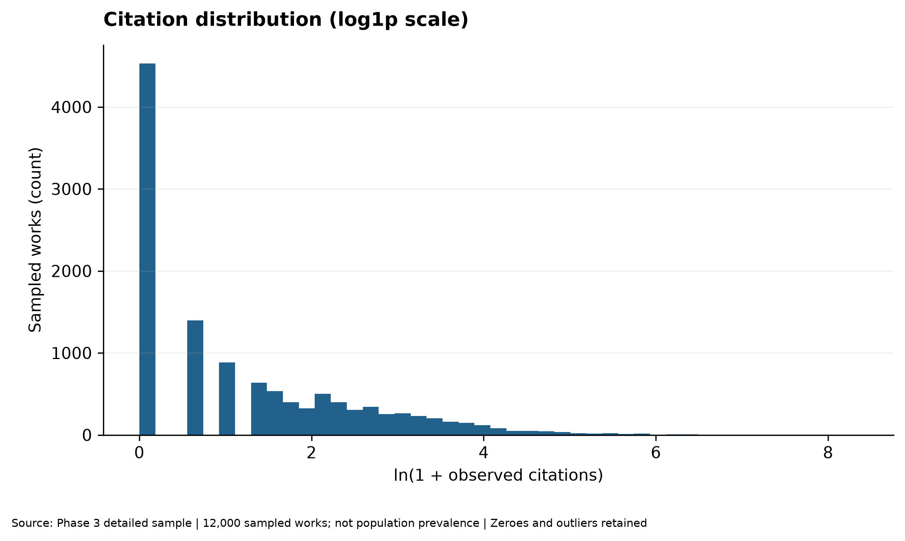
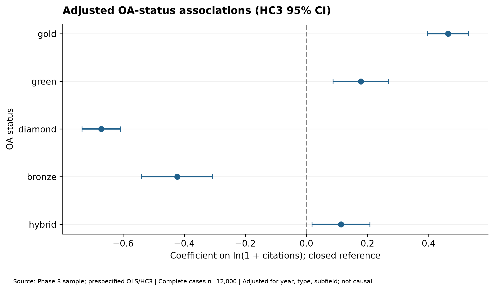
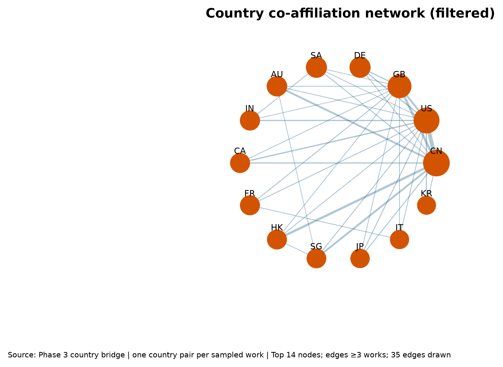

# AI Research Trends & Scientific Impact

**A Bibliometric and Machine Learning Analysis Using OpenAlex**

This university Introduction to Data Science project studies how AI research
evolved during the six complete calendar years 2020–2025, how citation impact
varies after accounting for time and field, how Open Access is associated with
impact, and how institutions and countries collaborate.

The project prioritizes reproducible data collection, transparent population and
sample definitions, tidy analytical tables, data-quality reporting, and cautious
interpretation. It does **not** treat citations as scientific quality.

## Current status

Phase 2 collection completed on 2026-10-19 UTC. The refreshed primary
non-retracted population contains 937,493 works; a proportional six-year sample
of 12,000 unique works was collected and passed the read-only page and JSONL
verifier. The all-work sensitivity population contains 942,825 works. Phase 3
converted the verified sample into eight typed, integrity-checked Parquet
tables. See the [Phase 2 collection report](reports/PHASE2_COLLECTION_REPORT.md)
and [Phase 3 data-quality report](reports/PHASE3_DATA_QUALITY_REPORT.md).
Phase 4 has completed the four research-question analyses using 19 derived
summary tables, 22 figure pairs and a reproducible [research report](reports/PHASE4_ANALYSIS_REPORT.md).
Phase 5's first literature-discovery feasibility audit is complete. Its G1/G2
decision is **REVISE**, so no supervised recommender or website has been claimed.
See the [feasibility](reports/PHASE5_FEASIBILITY_REPORT.md),
[RQ5 reference EDA](reports/PHASE5_REFERENCE_EDA_REPORT.md), and
[ML decision](reports/PHASE5_ML_PILOT_REPORT.md) reports.

## Study design in one minute

- Period: `2020-01-01` through `2025-12-31`; any 2026 result must be labeled YTD.
- Population frame: OpenAlex articles, reviews, and preprints whose **primary**
  topic is in subfield 1702 (Artificial Intelligence) or 1707 (Computer Vision
  and Pattern Recognition).
- Primary estimands exclude known retractions with `is_retracted:false`; parallel
  all-work aggregates are retained for sensitivity analysis.
- Population trends: use complete API `group_by` results where possible.
- Detailed records: fixed-seed server-side samples with explicitly nominal design
  weights, never an artificially balanced category sample used as prevalence.
- Classification has two non-equivalent layers: overlapping OpenAlex-native topic
  membership and separately reported custom title/abstract rules for LLM,
  Multimodal AI, and RAG. Primary-topic analyses remain a third, single-label view.
- Unit of analysis: a unique canonical OpenAlex Work ID. Author, institution,
  topic, and country links live in separate bridge tables in Phase 3.
- Impact: prefer OpenAlex FWCI (normalized by year, type, and primary subfield),
  citation percentiles, and age-aware sensitivity analyses. Raw citations are
  descriptive counts, not quality scores.

See [the collection strategy](docs/DATA_COLLECTION_STRATEGY.md) for the sampling
estimand and weighting details.

## Setup

```bash
python -m venv .venv
source .venv/bin/activate
pip install --upgrade pip
pip install -e ".[dev]"
cp .env.example .env
```

Add a free key to `.env` before non-trivial collection. OpenAlex currently
requires a verified key to follow a cursor after its first page. Never commit it.

## Phase 1 commands

All commands have `--help`.

```bash
openalex-validate-topics --help
openalex-discover-topics --help
openalex-collect-aggregates --help
openalex-collect-pilot --help
openalex-profile-pilot --help
openalex-audit-categories --help
openalex-plan-sample --help
openalex-collect-stratified --help
openalex-verify-collection --help

openalex-validate-topics
openalex-discover-topics
openalex-collect-aggregates
openalex-collect-pilot --size 1000 --seed 20251019
openalex-profile-pilot data/interim/pilot_<UTC>/works.jsonl
openalex-audit-categories data/interim/pilot_<UTC>/works.jsonl
jupyter nbconvert --execute --to notebook --inplace \
  notebooks/01_data_quality.ipynb
pytest
```

Without installing the package, use:

```bash
PYTHONPATH=src python -m ai_research_trends.crawling.validate_topics
PYTHONPATH=src python -m ai_research_trends.crawling.discover_topics
PYTHONPATH=src python -m ai_research_trends.crawling.collect_aggregates
PYTHONPATH=src python -m ai_research_trends.crawling.collect_pilot --size 1000
```

## Phase 2 collection and reproducibility

The completed local production run is
`data/raw/openalex_stratified/stratified_20261019T155909Z/`. Its raw pages,
JSONL outputs, population counts, and sampling plan are Git-ignored and must be
backed up separately. Verify the existing run without modifying it:

```bash
openalex-verify-collection \
  data/raw/openalex_stratified/stratified_20261019T155909Z/manifest.json
openalex-profile-pilot \
  data/raw/openalex_stratified/stratified_20261019T155909Z/works.jsonl \
  --output data/metadata/phase2_profile.json
```

To reproduce the acquisition as a **new** run, generate and validate a fresh
plan from current OpenAlex aggregates:

```bash
openalex-collect-aggregates \
  --output data/metadata/population_counts_pre_phase2.json
openalex-plan-sample \
  --population-counts data/metadata/population_counts_pre_phase2.json \
  --sample-size 12000 \
  --output data/metadata/phase2_sampling_plan.json
openalex-collect-stratified \
  --plan data/metadata/phase2_sampling_plan.json
```

The final command is a safe dry run. After checking the plan and API key, a new
collection can be started explicitly:

```bash
openalex-collect-stratified \
  --plan data/metadata/phase2_sampling_plan.json \
  --execute
```

Resume a failed run with the same plan, config, seed, and page size:

```bash
openalex-collect-stratified \
  --plan data/metadata/phase2_sampling_plan.json \
  --resume-manifest data/raw/openalex_stratified/stratified_<UTC>/manifest.json \
  --resume-verify all \
  --execute
```

The default `all` mode re-fetches every checkpointed page and compares ordered Work
IDs before new pages are requested. `sampled` checks the first and last page per
started stratum, while `minimal` checks the first. Recovered orphan pages are always
checked. A mismatch fails safely and preserves both responses. No mode proves full
snapshot consistency because OpenAlex does not expose snapshot isolation; even
`all` cannot guarantee unchanged metadata or changes occurring after the probe.

Raw pages and probe bodies use an atomic `.part`-then-rename protocol. Interrupted
temporary files and malformed unregistered pages are moved to the run's quarantine
directory and recorded in its manifest before replacement. Completed runs cannot
be resumed. Verify one without writing to it using:

```bash
openalex-verify-collection \
  data/raw/openalex_stratified/stratified_<UTC>/manifest.json
```

OpenAlex documents random `sample` and reproducible `seed` behavior. The plan's
`n/N` inclusion probabilities and `N/n` weights are nevertheless labeled nominal:
the public API documentation does not establish uniform inclusion or stability
across database updates.

The 12,000-work collector retains validated records and its ID set in memory until
final JSONL creation. For substantially larger targets, stream page records to an
append-only staging file and maintain uniqueness in DuckDB/SQLite instead of
accumulating Python dictionaries; continue to keep immutable page responses and an
atomic completion manifest.

Each pilot run creates:

- `data/raw/openalex/pilot_<UTC>/page_####.json`: unchanged HTTP bodies;
- `data/raw/openalex/pilot_<UTC>/works.jsonl`: lossless record-level raw export;
- `data/raw/openalex/pilot_<UTC>/manifest.json`: query, timestamps, page hashes,
  rate-limit metadata, and completeness flags;
- `data/interim/pilot_<UTC>/works.jsonl`: deduplicated extracted records.

Raw and derived data are ignored by Git. Keep them in durable project storage and
archive manifests with submitted reports.

## Phase 3 preprocessing and validation

The eight local Parquet outputs are reproducible only when the verified Phase 2
raw/interim JSONL, collection manifest, sampling plan, aggregate artifact,
quality profile and category config are available. GitHub does not contain
these Git-ignored data artifacts. No OpenAlex key or network access is needed.
The command refuses an existing output directory and never modifies Phase 2
evidence. Use a new directory for each deterministic rerun.

```bash
openalex-preprocess --help
openalex-validate-processed --help
openalex-report-processed --help

openalex-preprocess \
  --source-jsonl data/interim/openalex_stratified/stratified_20261019T155909Z/works.jsonl \
  --source-manifest data/raw/openalex_stratified/stratified_20261019T155909Z/manifest.json \
  --plan data/metadata/phase2_sampling_plan.json \
  --population data/metadata/population_counts_pre_phase2.json \
  --phase2-profile data/metadata/phase2_profile.json \
  --config config/topics.yaml \
  --output-dir data/processed/openalex_stratified/stratified_20261019T155909Z

openalex-validate-processed \
  --output-dir data/processed/openalex_stratified/stratified_20261019T155909Z \
  --plan data/metadata/phase2_sampling_plan.json \
  --population data/metadata/population_counts_pre_phase2.json \
  --config config/topics.yaml
# For a deterministic byte-level comparison, repeat the preprocess command
# above with --output-dir ending in stratified_20261019T155909Z_rerun.
openalex-report-processed \
  data/processed/openalex_stratified/stratified_20261019T155909Z \
  --compare-dir data/processed/openalex_stratified/stratified_20261019T155909Z_rerun \
  --output reports/PHASE3_DATA_QUALITY_REPORT.md
jupyter nbconvert --execute --to notebook \
  --output 02_processed_data_quality.executed.ipynb \
  notebooks/02_processed_data_quality.ipynb
```

The processed run directory contains `manifest.json` (input/output SHA-256,
row counts, schema version, validation checks, code hash) and `quality.json`
(missingness by year/type and row-level quarantine issues). The nominal
`N_h/n_h` year-stratum weights do not imply verified uniform OpenAlex inclusion.
Population trends use `population_year_counts.parquet`, never counts from the
12,000-work sample. Native topics and custom text-rule labels remain distinct.
Phase 5 ML training is not yet implemented; a reference-graph feasibility audit
and exploratory RQ5 extension are available below.

The current processor streams the source JSONL line by line but holds normalized
tables in memory until deterministic sorting and Parquet export. For a much
larger corpus, move relationship tables to partitioned Arrow/DuckDB staging
instead of scaling this in-memory run unchanged.

## Phase 4 analysis and reproducibility

Phase 4 analyzes the verified Phase 3 data without new OpenAlex requests. It
uses complete population aggregates for publication volume, and the distinct
12,000-work sample for citation, OA and collaboration analyses. Its fixed
[statistical plan](docs/PHASE4_STATISTICAL_ANALYSIS_PLAN.md) describes the
conditional, non-causal models. The [research report](reports/PHASE4_ANALYSIS_REPORT.md)
links all 22 verified PNG figures, now published in
[`reports/figures/phase4/`](reports/figures/phase4/); the original 300-DPI
PNG/SVG pairs remain in the immutable local analytical run. The
[figure-publication manifest](reports/PHASE4_FIGURE_PUBLICATION.json) records
source and published SHA-256 values. Local machine-readable outputs are Git-ignored under
`data/analysis/phase4_stratified_20261019T155909Z_v3/`; its `manifest.json`
records input/output SHA-256, table grains, denominators and 18 validation
checks. The four notebooks `03`–`06` inspect those local results.

### Phase 4 — Research Results & Visualizations

The complete non-retracted AI/CV primary-subfield corpus grew from 125,506
works in 2020 to 232,476 in 2025. All citation, OA, text-rule and network
findings below instead describe the separate 12,000-work detailed sample;
they are not population prevalence estimates. RQ3 reports observational,
conditional associations, not effects caused by OA. A compact
[slide-ready presentation brief](docs/PHASE4_PRESENTATION_BRIEF.md) accompanies
the full [academic report](reports/PHASE4_ANALYSIS_REPORT.md).

| Preview | What it shows |
|---|---|
|  | RQ1: complete-population annual AI/CV work counts. |
|  | RQ1: selected, overlapping OpenAlex-native population topic series. |
|  | RQ2: skewed observed citations among sampled works. |
|  | RQ3: conditional log1p-citation associations versus closed OA, with HC3 intervals; not causal effects. |
|  | RQ4: sampled co-affiliation links, not a global collaboration map. |

All analysis commands have `--help`. To reproduce without overwriting a
completed run, use a **new** output directory. To republish the verified
figures or re-render the committed report, use the dedicated commands; they
verify the original run and do not alter it:

```bash
openalex-analyze-phase4 --help
openalex-validate-phase4 --help
openalex-publish-phase4-figures --help
openalex-publish-phase4-report --help
openalex-publish-phase4-figures \
  data/analysis/phase4_stratified_20261019T155909Z_v3
openalex-publish-phase4-report \
  data/analysis/phase4_stratified_20261019T155909Z_v3 \
  --output reports/PHASE4_ANALYSIS_REPORT.md
openalex-analyze-phase4 \
  --processed-dir data/processed/openalex_stratified/stratified_20261019T155909Z \
  --output-dir data/analysis/phase4_reproduction \
  --plan data/metadata/phase2_sampling_plan.json \
  --population data/metadata/population_counts_pre_phase2.json \
  --config config/topics.yaml \
  --analysis-plan docs/PHASE4_STATISTICAL_ANALYSIS_PLAN.md \
  --seed 20261023
openalex-validate-phase4 \
  data/analysis/phase4_reproduction \
  --compare-dir data/analysis/phase4_stratified_20261019T155909Z_v3
jupyter nbconvert --execute --to notebook --output-dir /tmp \
  notebooks/03_publication_trends.ipynb \
  notebooks/04_citation_impact.ipynb \
  notebooks/05_open_access_analysis.ipynb \
  notebooks/06_collaboration_networks.ipynb
pytest -q -ra
pip check
```

The comparison checks all output hashes under identical input and settings;
the completed local Phase 4 rerun matched all 64 outputs byte
for byte (19 CSV, 44 figures and one report). The notebooks point to the
versioned verified local run; adapt their path if reproducing elsewhere.
Sample counts are not population counts. Nominal year weights are not verified
inverse inclusion probabilities, and OA associations do not establish causality.

## Phase 5 literature-discovery feasibility pilot

The exploratory [RQ5 plan](docs/PHASE5_RQ5_PLAN.md) asks what prior literature
the sampled AI/CV works cite. The verified 12,000-work sample has 289,110 unique
reference edges. Under the documented title/abstract/date/≥10-reference rules,
5,141 works are eligible queries. For the 909 eligible 2023 queries, the
2020–2022 historical ≥2-citer pool contains 8,183 candidate IDs; median
reference-ID overlap is only 10.0%. Most candidate publication dates are not
available locally. This is **pool coverage, not candidate-generation recall**.
The first gate was **REVISE**; no supervised ranking, inference model or website
was run. See the [actual first audit](reports/PHASE5_FEASIBILITY_REPORT.md) and
[RQ5 EDA](reports/PHASE5_REFERENCE_EDA_REPORT.md). Four small diagnostic figures
are published under [`reports/figures/phase5/`](reports/figures/phase5/).

The audit uses only local, previously verified Phase 3 data—no API call or new
collection. It refuses an existing output directory and, by default, refuses
existing report names. Reproduce under a **new** versioned output and report
directory to preserve the completed run:

```bash
openalex-audit-literature --help
openalex-verify-literature-audit --help
openalex-audit-literature \
  --processed-dir data/processed/openalex_stratified/stratified_20261019T155909Z \
  --plan data/metadata/phase2_sampling_plan.json \
  --population data/metadata/population_counts_pre_phase2.json \
  --config config/topics.yaml \
  --output-dir data/analysis/phase5_literature_reproduction \
  --report-dir reports/phase5_reproduction \
  --published-figure-dir reports/figures/phase5_reproduction \
  --seed 20261028
openalex-verify-literature-audit \
  data/analysis/phase5_literature_reproduction \
  --processed-dir data/processed/openalex_stratified/stratified_20261019T155909Z \
  --report-dir reports/phase5_reproduction \
  --published-figure-dir reports/figures/phase5_reproduction
pytest -q -ra
pip check
```

The completed local audit is
`data/analysis/phase5_literature_pilot_20261028_v4/`; its manifest records
source and output SHA-256 checksums. Those detailed tables and the older local
audit iterations are Git-ignored. Model training, model evaluation and inference
commands intentionally do not exist yet because the feasibility gate failed.
The bounded follow-up used **all** 2020–2022 edge-bearing sampled works (not
only ML-eligible historical queries), raising the ≥2-pool 2023 median ID overlap
from 10.0% to 12.1%. It then enriched 1,000 historically selected IDs (973
retrieved; 27 unavailable) and compared three simple retrieval baselines on
the same date-screened subset. The best fusion baseline reached only 2.53%
mean end-to-end Recall@20 against observed 2023 references. The final gate is
**NO-GO for citation-aware discovery as the main supervised ML task**; this
does not invalidate the RQ5 reference EDA. See the [coverage reassessment](reports/PHASE5_COVERAGE_REASSESSMENT.md),
[retrieval diagnostic](reports/PHASE5_RETRIEVAL_DIAGNOSTIC.md), and
[final decision with audited alternatives](reports/PHASE5_FINAL_DECISION.md).
No extra historical crawl or full-scale model training was started.

Reproduce the follow-up from the local verified Phase 3 data (Git-ignored;
not downloadable from this repository) under **new** output directory names:

```bash
openalex-reassess-literature --help
openalex-enrich-candidates --help
openalex-diagnose-retrieval --help
openalex-reassess-literature --output-dir data/analysis/phase5_reassessment_reproduction
openalex-enrich-candidates \
  --output-dir data/analysis/phase5_candidate_enrichment_reproduction \
  --maximum 1000
openalex-enrich-candidates \
  --output-dir data/analysis/phase5_candidate_enrichment_reproduction \
  --verify-only
openalex-diagnose-retrieval \
  --enrichment-dir data/analysis/phase5_candidate_enrichment_reproduction \
  --output-dir data/analysis/phase5_retrieval_reproduction
```

The enrichment command requires a local `OPENALEX_API_KEY` in Git-ignored `.env`;
the read-only verification and other two commands do not call the API. The
reassessment's five output hashes and retrieval diagnostic's three deterministic
CSV hashes matched independent reruns. Timing diagnostics are intentionally kept
outside deterministic CSV outputs. These are bounded proxy results, not a
full-pool temporal-coverage estimate or human relevance evaluation.

## Phase 6A topic-classification feasibility pilot

The [pre-model selection protocol](docs/PHASE6_TOPIC_SELECTION_PROTOCOL.md)
fixes 2020–2023 training, 2024 validation, a locked 2025 test, duplicate/version
grouping, and the provisional 120/30 per-topic support rule. The actual local
pilot found five scope-reviewed topics meeting that rule, below the intended
8–15-topic catalogue. A five-class diagnostic model was therefore evaluated
only as a **non-confirmatory** silver-label agreement experiment. The outcome
and its scientific limitations are in the [feasibility report](reports/PHASE6A_TOPIC_CLASSIFICATION_FEASIBILITY.md)
and [reviewer handoff](reports/PHASE6A_REVIEW_HANDOFF.md). No human-labelled
validation has yet been performed; see the [blind annotation protocol](docs/PHASE6_HUMAN_ANNOTATION_GUIDELINES.md).

The Phase 6A run uses only verified local Phase 3 Parquet data. No citation,
year, topic score, or source metadata is supplied as a model feature. To
reproduce it in a fresh Git-ignored directory (never reuse a completed output
directory):

```bash
pip install -e ".[dev]"
openalex-pilot-topics --help
openalex-pilot-topics --output-dir data/analysis/phase6_topic_pilot_reproduction
pytest -q -ra
pip check
```

The run manifest hashes each CSV, the support figure, the verified input tables
and catalogue configuration. The dedicated locked-test file has only 2025 Work
IDs and version groups; the separate source-label audit includes descriptive
2025 counts but these were not used for selection, fitting or evaluation. The
Git-ignored annotation template and answer
key remain local. The published [topic-support chart](reports/figures/phase6/topic_support.png)
shows sample counts, not population topic prevalence.

## Repository layout

```text
config/                         study and category definitions
docs/                           proposal, methods, dictionary, feasibility report
data/raw/                       immutable API response bodies (Git-ignored)
data/interim/                   extracted/normalized intermediate data (Git-ignored)
data/processed/                 Phase 3 Parquet analytical tables (Git-ignored)
data/analysis/                  Phase 4–6 local CSV results and manifests (Git-ignored)
data/metadata/                  manifests and quality reports (Git-ignored)
src/ai_research_trends/
  crawling/                     API client and collection CLIs
  preprocessing/               Phase 3 table builders
  features/                    bibliometric feature engineering
  analysis/                    Phase 4 statistical analysis
  ml/                          Phase 5 audits and Phase 6A silver-label pilot
notebooks/                      thin, numbered presentation notebooks
dashboard/                      Phase 6 application
models/                         fitted artifacts (Git-ignored)
reports/                        reports and figures
tests/                          unit tests
```

All importable modules live under the single `ai_research_trends` package; all
installed CLI entry points in `pyproject.toml` target that package.

## Tested environment

The final review ran on Python 3.12.3 (the project supports Python 3.11+) with:

| Package | Tested version | Package | Tested version |
|---|---:|---|---:|
| requests | 2.34.2 | PyYAML | 6.0.3 |
| python-dotenv | 1.2.4 | pytest | 8.4.2 |
| pandas | 2.3.3 | numpy | 2.5.4 |
| pyarrow | 21.0.0 | DuckDB | 1.5.6 |
| SciPy | 1.18.1 | scikit-learn | 1.9.1 |
| matplotlib | 3.11.2 | seaborn | 0.13.2 |
| JupyterLab | 4.6.4 | nbclient | 0.11.0 |

## Reproducibility and ethics

OpenAlex is a changing research graph. Every run records retrieval time, exact
parameters, raw-body SHA-256 hashes, and API-returned query metadata. Topic
assignments changed substantially in October 2026; do not compare a newly
retrieved series with a pre-change export without documenting that break.

Coverage, author disambiguation, affiliation matching, references, abstracts,
topics, countries, and OA status can all be missing or wrong. Results describe
OpenAlex coverage under the declared design—not all research activity or research
quality. No causal claim is made from the OA/impact association.
