# PHÂN TÍCH XU HƯỚNG NGHIÊN CỨU AI/CV VÀ HỆ THỐNG HỖ TRỢ KHÁM PHÁ CHỦ ĐỀ DỰA TRÊN OPENALEX

**Báo cáo dự án Nhập môn Khoa học dữ liệu · Bản thảo có thể tái tạo · 01/11/2026**

> Báo cáo này trình bày kết quả đã kiểm chứng, không phải bằng chứng một hệ thống phân loại chủ đề tự động đã được thẩm định bởi chuyên gia. Đánh giá ngữ nghĩa của hai người chấm còn thiếu; tập kiểm thử 2025 chưa được mở.

## Tóm tắt

Dự án xây dựng quy trình thu thập, chuẩn hóa, phân tích thống kê và học máy trên dữ liệu học thuật OpenAlex. Khung nghiên cứu được định nghĩa chặt: công trình công bố từ 2020-01-01 đến 2025-12-31, thuộc loại article/review/preprint, có *primary subfield* 1702 (Artificial Intelligence) hoặc 1707 (Computer Vision and Pattern Recognition); ấn phẩm bị rút khỏi xuất bản được loại khỏi ước lượng chính. Tổng thể không đồng nghĩa với “mọi nghiên cứu AI trên thế giới”. Số liệu xu hướng được lấy từ tổng hợp trên toàn khung OpenAlex, tách biệt với mẫu chi tiết 12.000 công trình. Mẫu cho phép nghiên cứu trích dẫn, truy cập mở (OA), hợp tác và khám phá giấy tờ, nhưng xác suất chọn của API chưa được chứng minh, vì vậy trọng số mẫu chỉ mang tính danh nghĩa.

Phân tích mô tả và hồi quy làm rõ tác động của tuổi bài báo, kiểu công trình và dữ liệu thiếu. Thành phần ML dự đoán nhãn chủ đề chính do OpenAlex gán cho 14 chủ đề chọn trước, dùng TF-IDF và Linear SVM; macro-F1 trên 681 công trình phát triển năm 2024 là 0,8808. Tỷ lệ chấp nhận nhầm ngoài danh mục đạt 21,66% trong đánh giá phát triển, lớn hơn mục tiêu hiệu chỉnh. Sản phẩm cuối là trang khám phá dữ liệu cục bộ và công cụ *gợi ý cần người dùng xác nhận*, không phải bộ phân loại được kiểm định trên 2025 hay một thước đo chất lượng khoa học.

**Từ khóa:** OpenAlex; thư mục học; trí tuệ nhân tạo; thị giác máy tính; truy cập mở; TF-IDF; Linear SVM; nhãn bạc.

## 1. Giới thiệu

### 1.1 Bối cảnh và vấn đề

Người mới tham gia nghiên cứu AI/CV đối diện lượng công trình lớn, thay đổi nhanh, nhiều thuật ngữ và bằng chứng trích dẫn không đồng đều. Các trang tìm kiếm học thuật cung cấp bản ghi nhưng ít khi phân biệt rạch ròi số liệu tổng thể với mẫu chi tiết hoặc nêu độ bất định của nhãn chủ đề. Mục tiêu của dự án là tạo một nghiên cứu Khoa học dữ liệu tái lập được đồng thời cung cấp giao diện tra cứu có phạm vi rõ ràng.

### 1.2 Câu hỏi nghiên cứu

RQ1: Số công trình và chủ đề nghiên cứu trong khung AI/CV đã thay đổi như thế nào giai đoạn 2020–2025? RQ2: Chỉ báo trích dẫn khác nhau ra sao giữa năm, loại công trình và phân ngành? RQ3: OA liên hệ với chỉ báo trích dẫn như thế nào sau khi xét yếu tố thành phần? RQ4: Dữ liệu liên kết cơ quan và quốc gia thể hiện hợp tác ra sao? RQ5: Mạng tài liệu tham khảo trong mẫu có đặc điểm gì, và có đủ cho hệ gợi ý tài liệu hay không? RQ6: Nhãn chủ đề OpenAlex phù hợp đến đâu để xây dựng bài toán phân loại văn bản có giới hạn?

### 1.3 Đóng góp và phạm vi

Đóng góp gồm: khung chọn công trình và nhật ký truy xuất có checksum; bảng phân tích quan hệ; đánh giá thiếu dữ liệu; kết quả RQ1–RQ6 có mẫu số rõ; so sánh mô hình theo thời gian; chính sách từ chối ngoài danh mục; giao diện sáu chức năng có chỉ dẫn giới hạn. Phân tích không bao phủ mọi ngành AI, không xác định quan hệ nhân quả OA–trích dẫn, không xác lập độ đúng ngữ nghĩa nếu chưa có chấm độc lập.

### 1.4 Người dùng và tình huống sử dụng

Đối tượng chính là sinh viên bắt đầu đọc tài liệu AI/CV, người hướng dẫn cần một bản tóm tắt có nguồn gốc, và người nghiên cứu muốn thăm dò một chủ đề trước khi tìm kiếm chuyên sâu. Một lượt sử dụng hợp lý bắt đầu từ xu hướng xuất bản ở mức tổng thể, chuyển sang bối cảnh của chủ đề và bài báo trong mẫu, sau đó nhập tiêu đề–tóm tắt để nhận tối đa ba gợi ý. Người dùng phải chọn hoặc sửa chủ đề trước khi xem Topic Brief. Gợi ý này không thay thế tra cứu thủ công, phản biện học thuật hay quyết định nơi công bố.

Sáu câu hỏi tạo thành một mạch dữ liệu khoa học: RQ1 dùng thống kê tổng thể; RQ2–RQ4 dùng quan sát chi tiết có lưu ý thiếu dữ liệu; RQ5 kiểm tra một ý tưởng ML trên mạng tham khảo và bác bỏ khi bằng chứng không đủ; RQ6 xác định giới hạn của nhãn chủ đề trước khi dùng chúng cho mô hình. Cách tách này ngăn việc trình bày thành công của bộ phân loại như bằng chứng rằng các suy luận thư mục học cũng đúng, hoặc ngược lại.

## 2. Cơ sở lý thuyết và nghiên cứu liên quan

OpenAlex là đồ thị tri thức học thuật có thực thể công trình, tác giả, tổ chức và chủ đề [1], [2]. Một công trình có thể mang nhiều chủ đề; *primary topic* là nhãn một giá trị và được gán bằng mô hình của OpenAlex, không phải nhãn chuẩn của chuyên gia [3]. Chỉ số trích dẫn bị ảnh hưởng bởi tuổi công trình và phạm vi ngành; số lần trích dẫn không đồng nhất với chất lượng. FWCI hỗ trợ so sánh tương đối trong giới hạn dữ liệu có sẵn, nhưng thiếu có hệ thống ở preprint trong mẫu này.

TF-IDF biểu diễn tầm quan trọng tương đối của thuật ngữ trong tập văn bản [4]. Complement Naive Bayes, Logistic Regression và Linear SVM tạo ba giả định học khác nhau; việc fit vectorizer chỉ trên tập huấn luyện giúp tránh rò rỉ dữ liệu [5], [6]. Mô hình chỉ học tương quan giữa văn bản tiêu đề/tóm tắt và nhãn chính OpenAlex. Dù đạt điểm cao so với nhãn bạc, nó vẫn có thể lặp lại sai lệch gán nhãn của nguồn. Công cụ khám phá tài liệu dựa trên đồ thị tham khảo được xem xét ở RQ5 nhưng đã bị loại khỏi nhiệm vụ ML chính do độ phủ ứng viên thấp [7].

### 2.1 Đơn vị đo lường và lớp phân loại

OpenAlex cung cấp thứ bậc domain–field–subfield–topic. Điều kiện khung nghiên cứu áp dụng lên *primary subfield*, trong khi một bài có thể có nhiều topic và chỉ một *primary topic*. Bởi vậy số bài có một topic bất kỳ có thể chồng lắp với các topic khác; tổng các cột topic không bắt buộc bằng tổng số Work ID. Ba nhãn LLM, RAG và Multimodal AI được xây từ quy tắc tiêu đề/tóm tắt, không được xem là các chủ đề OpenAlex chuyên biệt hay một danh mục đầy đủ. Phần trăm từ hai tầng phân loại không phải cùng một ước lượng nếu không xác định lại mẫu số và cách gán nhãn [3], [10].

### 2.2 Chỉ báo ảnh hưởng và giới hạn diễn giải

`cited_by_count` là số trích dẫn mà OpenAlex ghi nhận tại một thời điểm; nó thay đổi khi chỉ mục được cập nhật. Một công trình cũ có thời gian tích lũy dài hơn, nên so sánh năm không chuẩn hóa sẽ nghiêng về bài cũ. `fwci` là chỉ báo tương đối theo bối cảnh ngành/thời gian do nguồn cung cấp, không phải một đo lường trực tiếp về chất lượng hoặc tác động xã hội. Phân tích theo FWCI bị thiếu không ngẫu nhiên khi mọi preprint trong mẫu đều không có giá trị. OA cũng không được phân công ngẫu nhiên; loại công trình, thời điểm và lựa chọn đăng tải đồng thời liên quan tới OA và trích dẫn. Hồi quy quan sát giúp mô tả liên hệ có điều kiện nhưng không loại bỏ mọi yếu tố nhiễu.

### 2.3 Từ văn bản đến mô hình có quyền từ chối

TF-IDF giảm trọng số của từ xuất hiện rộng và có thể biểu diễn cả unigram/bigram, phù hợp với tên phương pháp kỹ thuật. ComplementNB xây quy tắc xác suất đơn giản để xử lý phân bố từ; Logistic Regression học ranh giới tuyến tính phân biệt nhiều lớp; Linear SVM tối đa hóa biên phân loại. Không mô hình nào tự biết một bản thảo thuộc ngoài 14 lớp đã chọn. Chính sách *open-set* dùng điểm biên để từ chối hoặc yêu cầu xác nhận, song điểm này không được hiệu chỉnh thành xác suất đúng ngữ nghĩa. Kết quả phát triển của bộ từ chối phải được đọc cùng tỷ lệ nhận nhầm ngoài danh mục và giới hạn nhãn bạc.

## 3. Thu thập dữ liệu và thiết kế mẫu

### 3.1 Hai lớp dữ liệu

Lớp **tổng thể** gồm các yêu cầu tổng hợp OpenAlex trên bộ lọc ngày, loại, primary subfield và trạng thái rút bài nhất quán. Lớp **chi tiết** gồm 12.000 Work ID duy nhất, phân tầng theo năm 2020–2025. Số mẫu theo năm lần lượt là 1.607; 1.650; 1.615; 1.865; 2.287; 2.976. Tổng thể chính không rút bài tại thời điểm thu thập Phase 2 là **937.493** công trình; tổng thể bao gồm rút bài để phân tích nhạy cảm là **942.825** [8]. Đây là ảnh chụp dữ liệu thay đổi theo thời gian, không phải hằng số toàn cục.

### 3.2 Thu thập và kiểm toán

Quy trình dùng API có xác thực, giới hạn tốc độ, phân trang, lưu phản hồi gốc, manifest và SHA-256. 123 trang dữ liệu đã được xác minh; 12.000 ID chuẩn không trùng, raw và interim JSONL khớp checksum [8]. Phân bổ theo năm dùng phương pháp số dư lớn nhất từ số dân số mỗi tầng; xác suất chọn và trọng số tính từ kế hoạch được gọi là *danh nghĩa* vì OpenAlex không cam kết thiết kế lấy mẫu xác suất. Không dùng một mẫu cân bằng theo chủ đề để suy ra độ phổ biến trong tổng thể.

### 3.3 Mở rộng dữ liệu ML

2.515 bản ghi bổ sung được thu thập có chủ đích để tăng hỗ trợ các chủ đề của huấn luyện lịch sử, tạo 14.515 bản ghi nguồn và 14.470 nhóm phiên bản [9]. Tập mở rộng chỉ phục vụ ML, không được đưa vào số liệu xu hướng, trích dẫn, OA hoặc hợp tác của tổng thể/mẫu gốc. Việc tăng hỗ trợ lớp không làm mẫu trở nên đại diện cho dân số AI/CV.

### 3.4 Định nghĩa ước lượng và kiểm soát chọn mẫu

| Bảng 1. Tầng năm | Tổng thể chính N_h | Mẫu chi tiết n_h | Trọng số danh nghĩa N_h/n_h |
|---|---:|---:|---:|
| 2020 | 125.506 | 1.607 | 78,100 |
| 2021 | 128.893 | 1.650 | 78,117 |
| 2022 | 126.189 | 1.615 | 78,136 |
| 2023 | 145.735 | 1.865 | 78,142 |
| 2024 | 178.694 | 2.287 | 78,135 |
| 2025 | 232.476 | 2.976 | 78,117 |

Bảng 1 được chép từ kế hoạch lấy mẫu Phase 2 đã xác minh, không tính lại từ tệp 12.000 bài. Năm 2025 nhận nhiều bài nhất vì tổng thể cùng năm lớn nhất, không phải vì người nghiên cứu giả định đây là chủ đề quan trọng hơn. Trọng số hiển thị đã làm tròn ba chữ số thập phân; khi cần tái lập phép tính phải dùng giá trị đầy đủ trong kế hoạch JSON. Việc các trọng số gần nhau chỉ phản ánh phân bổ theo năm tương ứng với dân số, không chứng minh rằng mọi Work ID trong tầng có cùng xác suất được OpenAlex trả về. Cần tách *nhiệm vụ lập kế hoạch thu thập* với *khẳng định thiết kế xác suất*.

Điều kiện tuyển chọn áp dụng đồng thời lên `publication_date` từ 2020-01-01 đến 2025-12-31, loại `article`, `review`, `preprint`, primary subfield 1702 hoặc 1707, và `is_retracted=false` cho chuỗi chính. Chuỗi tất cả công trình chỉ khác ở điều kiện rút bài, được giữ cho phân tích nhạy cảm. Không lấy số đếm từ các truy vấn topic riêng rẽ rồi cộng lại vì một Work ID có thể xuất hiện ở nhiều topic. Kiểm tra hậu thu thập đối chiếu ngày chính xác, loại công trình, primary subfield, trạng thái rút bài và Work ID chuẩn; riêng năm công bố được so với ngày để phát hiện bất nhất [8].

Mỗi tầng năm nhận `n_h` mục tiêu theo phương pháp số dư lớn nhất từ `N_h`; hồ sơ kế hoạch ghi `N_h`, `n_h`, xác suất danh nghĩa `n_h/N_h` và trọng số danh nghĩa `N_h/n_h`. Đây là phép phân bổ tải thu thập, không là bằng chứng API tạo mẫu đều hoặc độc lập. Vì vậy đồ thị xu hướng chính dùng tổng hợp OpenAlex, không dùng ước lượng Horvitz–Thompson chưa được biện minh. Thống kê chi tiết được ghi rõ là trên mẫu 12.000; sự khác nhau giữa các nhóm có thể phản ánh cả chọn mẫu lẫn dữ liệu nguồn.

Quy trình tách kho raw, interim và processed. Mỗi trang phản hồi được lưu bất biến và có SHA-256; manifest ghi bộ lọc, seed, thời điểm, số trang và tình trạng hoàn thành. Kiểm tra khôi phục so ID của các trang đã tải với API để phát hiện thay đổi rõ ràng, nhưng API không cung cấp ảnh chụp đóng băng nên không thể chứng minh toàn bộ mẫu ổn định theo thời gian. Gói đã hoàn thành không bị ghi đè. Các lần mở rộng lịch sử ở Phases sau ở thư mục độc lập, tránh làm sai provenance của mẫu phân tích ban đầu [8], [9].

## 4. Tiền xử lý và kỹ thuật dữ liệu

Phản hồi OpenAlex là JSON lồng nhau: `primary_topic`, danh sách `topics`, `authorships`, `institutions`, `countries_distinct`, `referenced_works`, OA và chỉ mục đảo của abstract. Mỗi Work ID chuẩn hóa thành một dòng ở bảng works; các quan hệ nhiều-nhiều nằm trong bảng `work_topics`, `authorships`, `work_institutions`, `work_countries`, `references`, `category_membership`. Bảng `population_year_counts` được tạo từ tổng hợp đã kiểm chứng, không suy ra bằng 12.000 bản ghi [10].

Tiêu đề, DOI và tóm tắt thiếu được giữ null; abstract chỉ được dựng lại khi chỉ mục đảo hợp lệ. Mẫu Phase 2 có 2.558 tóm tắt, 2.678 FWCI, 2.902 thông tin tổ chức và 2.949 thông tin quốc gia không sẵn có; không thay FWCI thiếu bằng 0 [8]. Toàn bộ 2.678 preprint trong mẫu thiếu FWCI, nên so sánh theo FWCI loại trừ một kiểu công trình có hệ thống. Trích dẫn 0 được giữ như giá trị thật; ngoại lệ trích dẫn cao không bị xóa. Quốc gia là nơi liên kết cơ quan, không phải quốc tịch tác giả.

Phân tách ML theo thời gian: huấn luyện 2020–2023, phát triển 2024, kiểm thử 2025 giữ kín. Nhóm phiên bản ở cùng phía của phân tách để giảm rò rỉ do bài trùng/phiên bản. `TfidfVectorizer` được fit trong từng fold huấn luyện, không học từ 2024 hoặc 2025. Trước mỗi bước, manifest và checksum được đối chiếu; xuất bảng dùng định dạng Parquet có schema ổn định.

### 4.1 Từ bản ghi lồng nhau đến bảng có khóa rõ ràng

Tóm tắt OpenAlex lưu dưới dạng từ → danh sách vị trí. Bộ dựng lại kiểm tra cấu trúc, vị trí số nguyên hợp lệ và xung đột vị trí trước khi ghép theo thứ tự; trường thiếu vẫn null, cấu trúc hỏng được nêu trong kiểm toán chứ không thay bằng chuỗi giả. Work ID được chuẩn hóa sang dạng OpenAlex duy nhất. DOI được giữ dạng định danh chuẩn khi có, song DOI thiếu không loại bài. Bảng `works` chỉ có một hàng trên Work ID; bảng chủ đề, cơ quan, quốc gia và tham khảo dùng khóa ghép để ngăn phép nối vô tình nhân số bài. Khi tính số tổ chức hợp tác, số lượng cơ quan duy nhất theo Work ID được dùng thay vì số lần xuất hiện qua authorship.

Với `references`, cạnh hướng đi từ bài dẫn đến bài được dẫn. Phần lớn đích nằm ngoài 12.000 bài mẫu; giữ những cạnh này là thiết yếu cho RQ5. Ngược lại, một danh sách tham khảo rỗng ở bản ghi API không thể chứng minh tác giả không có tham khảo; nó chỉ phản ánh tình trạng quan sát. `work_countries` mô tả địa lý liên kết, không được đổi thành quốc tịch tác giả. Các giá trị thiếu của tổ chức/quốc gia khiến trạng thái hợp tác của một số bài không xác định, không phải mặc định `False` [10].

### 4.2 Chuỗi dữ liệu và chống rò rỉ trong ML

Một số biến dẫn xuất phục vụ EDA có công thức minh bạch. `log1p_citations = ln(1 + cited_by_count)` xác định cho số trích dẫn nguyên không âm, bao gồm 0. `zero_citation_flag` là `cited_by_count = 0`, không phải một mã thiếu dữ liệu. Tuổi công bố được tính tương đối với một ngày chốt quan sát chung nên không được trở thành số âm; ngày nguồn và ngày truy xuất cần được giữ trong manifest. `has_fwci` tách trường hợp không quan sát khỏi giá trị FWCI hợp lệ, không điền 0 cho chỗ trống. Số tác giả/cơ quan/quốc gia ở cấp Work ID được tính sau khi khử trùng khóa phù hợp; cờ hợp tác quốc tế chỉ xác định khi nguồn cung cấp đủ country affiliation. Các nhãn native và custom cùng được lưu nhưng có `analytical_layer` riêng, vì quy tắc lexical không có cùng độ bao phủ với taxonomy OpenAlex [10].

Tập huấn luyện bổ sung được ghép theo quy tắc Work ID và nhóm phiên bản, rồi cách ly train/dev/test. Tập 2025 chỉ được kiểm tra trạng thái niêm phong và tính toàn vẹn cơ học; không dùng nhãn hay dự đoán để chọn đặc trưng, siêu tham số hoặc ngưỡng. Khi huấn luyện chéo, `Pipeline` khớp từ vựng và IDF trên fold train, sau đó biến đổi fold validation. Không được lấy mô tả topic, score chủ đề, Work ID, năm, OA hay trích dẫn làm đầu vào dự đoán. Tên lớp cuối cùng và ngưỡng open-set là cấu hình đóng băng; manifest model gắn checksum của bộ dữ liệu, catalogue và bundle [9].

## 5. Khám phá dữ liệu và phân tích thống kê

### 5.1 RQ1 — Xu hướng công bố

Bảng 2 là số đếm toàn bộ khung chính không rút bài; không phải ước lượng từ mẫu. Giai đoạn 2020–2025, số quan sát tăng từ 125.506 lên 232.476; riêng 2025 tăng 30,10% so với 2024 trong ảnh chụp OpenAlex đã lưu [11]. Điều này mô tả số bản ghi OpenAlex trong khung, không chứng minh tốc độ sản xuất tri thức toàn cầu tương ứng. Khả năng lập chỉ mục hồi tố và thay đổi bộ phân loại chủ đề có thể làm thay đổi chuỗi sau này.

| Bảng 2. Năm | Số công trình trong tổng thể chính | Tăng trưởng năm sau/năm trước |
|---|---:|---:|
| 2020 | 125.506 | — |
| 2021 | 128.893 | 2,70% |
| 2022 | 126.189 | −2,10% |
| 2023 | 145.735 | 15,49% |
| 2024 | 178.694 | 22,62% |
| 2025 | 232.476 | 30,10% |

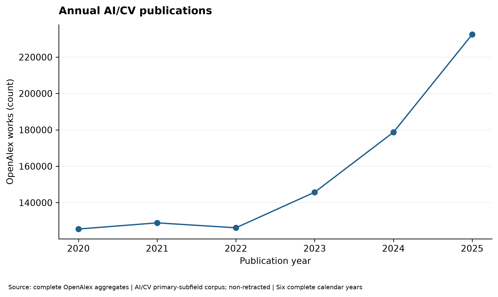

Chủ đề gốc OpenAlex, phân ngành và các nhãn từ quy tắc văn bản (LLM, RAG, đa phương thức) là các tầng đo khác nhau. Nhãn từ văn bản có thể chồng lắp, bỏ sót bài thiếu abstract và không thể đối chiếu số đếm như thể cùng phương pháp phân loại.

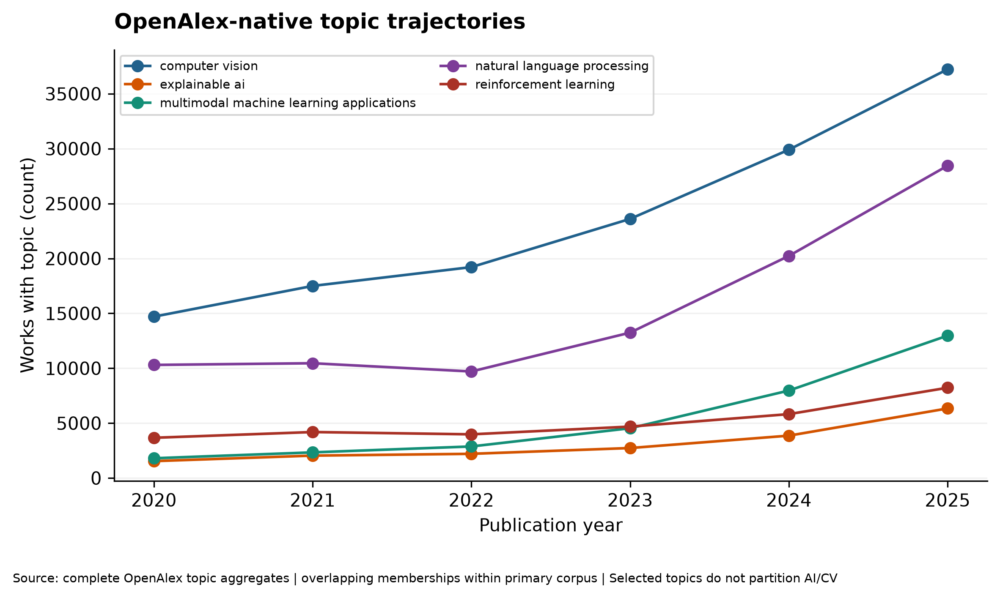

Chuỗi RQ1 tăng nhưng không đơn điệu: 2022 thấp hơn 2021 2,10%, rồi tăng rõ trong 2023–2025. “Đủ năm” ở 2025 không loại khả năng OpenAlex lập chỉ mục hồi tố hoặc sửa nhãn sau ngày truy xuất. Mọi đồ thị chủ đề bản địa là ảnh chụp riêng; nhãn custom từ văn bản không phải cùng thước đo. Tăng trưởng trong khung primary-subfield AI/CV cũng không thể ngoại suy sang tất cả công trình AI liên ngành [11].

### 5.2 RQ2 — Trích dẫn

Trên 12.000 công trình mẫu gốc, trung vị trích dẫn là 2, trung bình 11,24, phân vị 90 là 23 và tối đa 4.199; 37,75% có 0 trích dẫn [11]. Phân phối lệch phải mạnh, do vậy trung vị và phân phối theo năm hữu ích hơn việc chỉ so sánh trung bình. Tuổi bài và loại công trình giải thích một phần khác biệt quan sát; không suy luận chất lượng nghiên cứu từ trích dẫn thô. FWCI chỉ phân tích trên công trình có quan sát, đặc biệt không đại diện cho preprint trong mẫu.

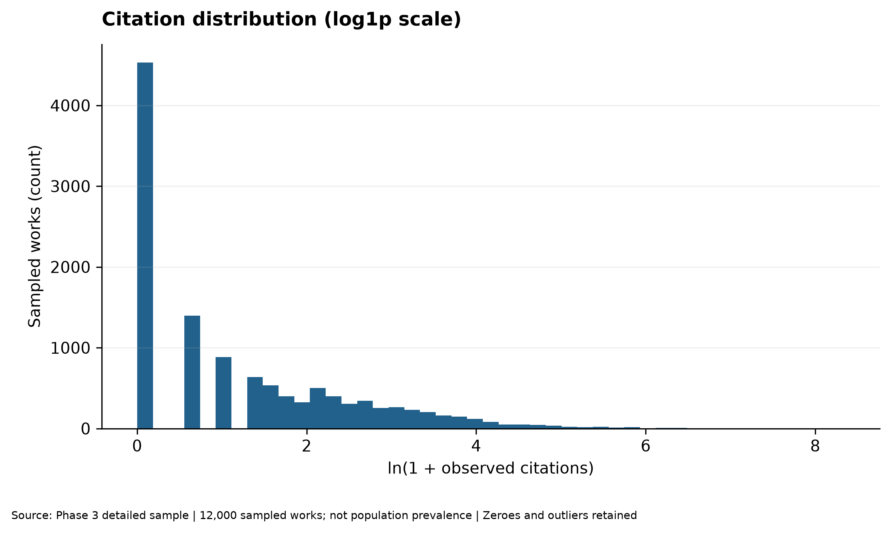

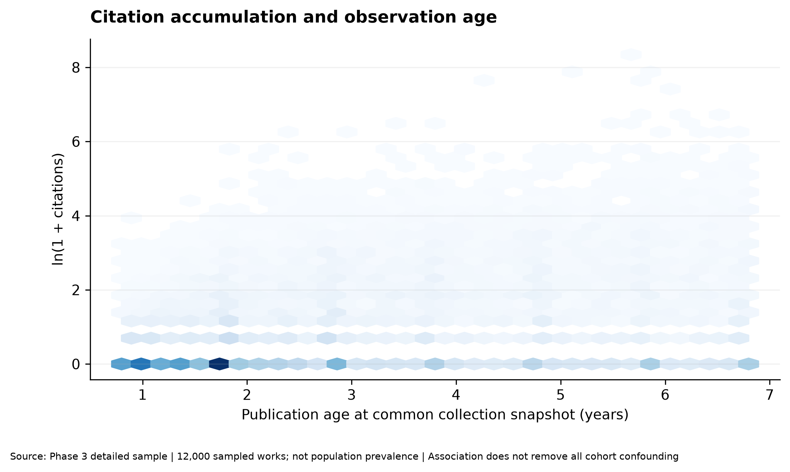

Giá trị cực đại 4.199 so với trung vị 2 cho thấy đuôi phân phối rất dài. Báo cáo giữ trung vị, phân vị và tỷ lệ 0 trích dẫn, không xóa ngoại lệ để làm “đẹp” dữ liệu. Bài 2025 có cửa sổ tích lũy ngắn hơn bài 2020; vì vậy trích dẫn thô theo năm không phản ánh chất lượng tương đối. Thiếu FWCI ở 2.678 bài, toàn bộ là preprint, khiến so sánh FWCI giữa preprint và article không thể thực hiện hợp lệ trong mẫu [8], [11].

### 5.3 RQ3 — Open Access và trích dẫn

Mô hình nhị phân chưa điều chỉnh (`unadjusted_binary`) gộp mọi trạng thái OA: hệ số OA so với closed là β = −0,330 trên `ln(1 + citations)`. Mô hình chính (`adjusted_status_year`) tách sáu trạng thái OA, kiểm soát năm công bố, loại bài và primary subfield với sai số chuẩn HC3. Gold so với closed: β = +0,463; khoảng tin cậy 95% [+0,396; +0,531]. Green so với closed: β = +0,178; khoảng tin cậy 95% [+0,087; +0,269] [11]. Hệ số dương là *liên hệ có điều kiện trong mô hình log(1 + trích dẫn)*, không phải OA gây tăng trích dẫn hay tăng chất lượng. `100(exp(0,463) − 1) ≈ 58,9%` là chênh lệch trung bình hình học có điều kiện của **1 + trích dẫn** dưới giả định mô hình; không phải “58,9% trích dẫn thô nhiều hơn trên mỗi bài”.

Nhóm Green gồm 3.559 công trình, trong đó 2.506 preprint; toàn bộ 2.678 preprint mẫu thiếu FWCI. Do thành phần nhóm khác nhau, không xem kết quả hai mô hình là “đảo dấu nhân quả”. Nhiễu chưa đo, lựa chọn xuất bản và đặc tả mô hình vẫn có thể ảnh hưởng kết quả.

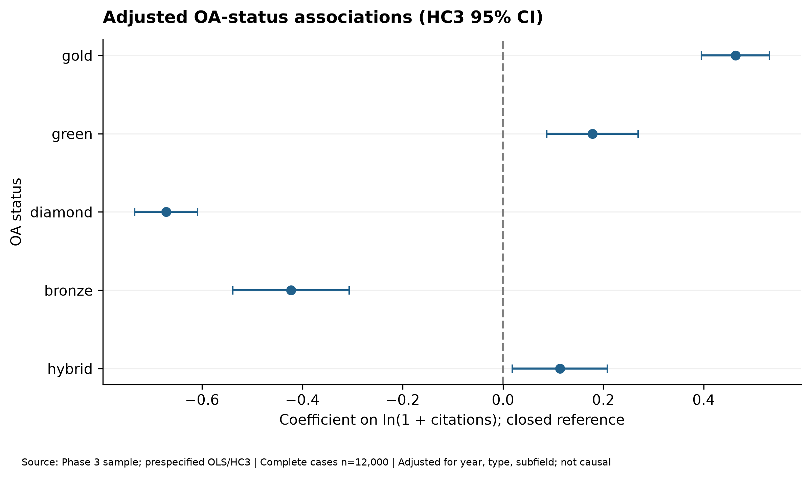

Với `Y = ln(1 + cited_by_count)`, β Gold là khác biệt trung bình có điều kiện trên thang log sau điều chỉnh, không phải chênh lệch trích dẫn thô. HC3 xử lý phương sai không đồng nhất dưới giả định mô hình nhưng không sửa sai lệch chọn mẫu, sai phân loại OA hay nhiễu chưa đo. Hệ số nhị phân âm và Gold/Green dương không phải “đảo dấu nhân quả”: đối tượng so sánh và điều kiện hóa khác nhau. Green chứa 2.506 preprint, vì vậy việc gộp sáu trạng thái che đi thành phần loại công trình. Kết quả thích hợp để đặt giả thuyết, không để khuyên OA nhằm tăng trích dẫn [11].

### 5.4 RQ4 — Hợp tác

Mạng hợp tác được dựng từ **đồng liên kết cơ quan trong mẫu**, không phải toàn mạng cộng tác AI/CV. Có 2.902 bài không có tổ chức và 2.949 bài không có quốc gia được quan sát; các trường hợp này không được mã hóa là “không hợp tác” [11]. Trong 7.970 bài đủ dữ liệu để xét hợp tác quốc tế, 1.979 có nhiều hơn một quốc gia liên kết (24,83%). Tỷ lệ này có điều kiện trên mẫu số đã biết, không đại diện cho 12.000 bài hay toàn dân số.

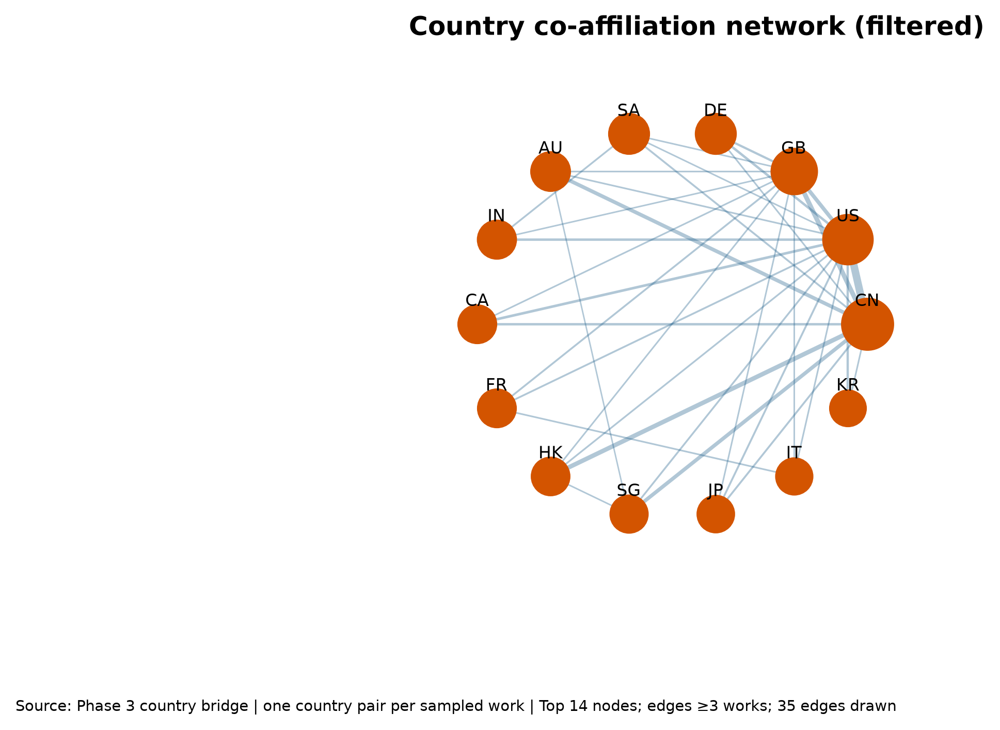

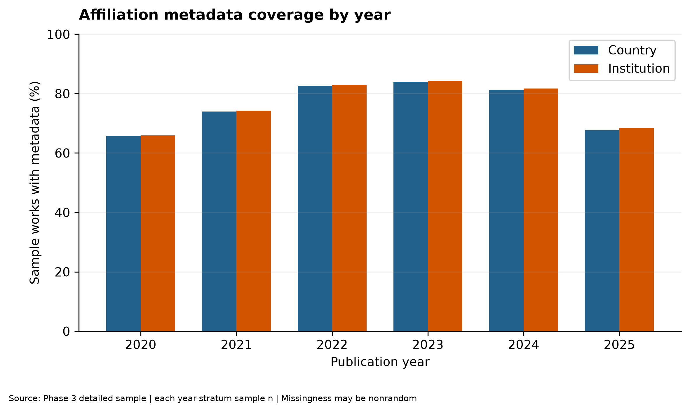

Nút mạng là quốc gia liên kết và cạnh là cùng xuất hiện trên một công trình trong mẫu. Bài nhiều tổ chức có thể đóng góp nhiều quan hệ; độ lớn nút không đo số nhà khoa học hay dự án độc lập. Dữ liệu quốc gia thiếu ở gần một phần tư mẫu; tỷ lệ 1.979/7.970 chỉ dành cho bài đủ thông tin để phân loại trạng thái hợp tác. Quốc gia ít hiện diện không nhất thiết ít hợp tác vì khả năng thiếu liên kết có thể khác theo nguồn và loại công trình [11].

### 5.5 RQ5 — Bối cảnh tham khảo

12.000 bài mẫu chứa 289.110 cạnh tham khảo duy nhất đến 207.102 Work ID được dẫn. 7.529 bài có danh sách tham khảo không rỗng; 4.471 danh sách quan sát được rỗng [7]. Độ phủ ứng viên lịch sử yếu: dùng mọi bài dẫn trước 2023, pool có ít nhất hai bài dẫn lịch sử đạt trung vị ID-overlap 12,1% trên 909 truy vấn năm 2023. Hệ truy xuất chẩn đoán giới hạn metadata đạt mean end-to-end Recall@20 2,53%; vì vậy **NO-GO** cho hệ gợi ý tài liệu trích dẫn là ML chính. Số ID được nhắc đến không đánh giá độ phù hợp của tài liệu chưa được dẫn.

Kiểm toán ban đầu yêu cầu bài dẫn lịch sử cũng đủ điều kiện làm truy vấn ML, cho trung vị overlap 10,0% ở ngưỡng hai bài dẫn. Nới sang mọi bài mẫu có cạnh hợp lệ giai đoạn 2020–2022 làm pool tăng từ 8.183 lên 12.019 ID và trung vị trên 909 truy vấn 2023 lên 12,1%; tỷ lệ không giao giảm từ 23,2% xuống 19,0% [7]. Đây là cải thiện nhỏ của **ID-overlap**, không phải Recall@20 hoặc độ phủ được xác thực về thời gian. Truy xuất metadata chỉ trả 973/1.000 ID chọn theo tần suất lịch sử, không tạo ra ID ngoài pool. Vì vậy quyết định NO-GO cho gợi ý trích dẫn làm nhiệm vụ ML chính vẫn có căn cứ.

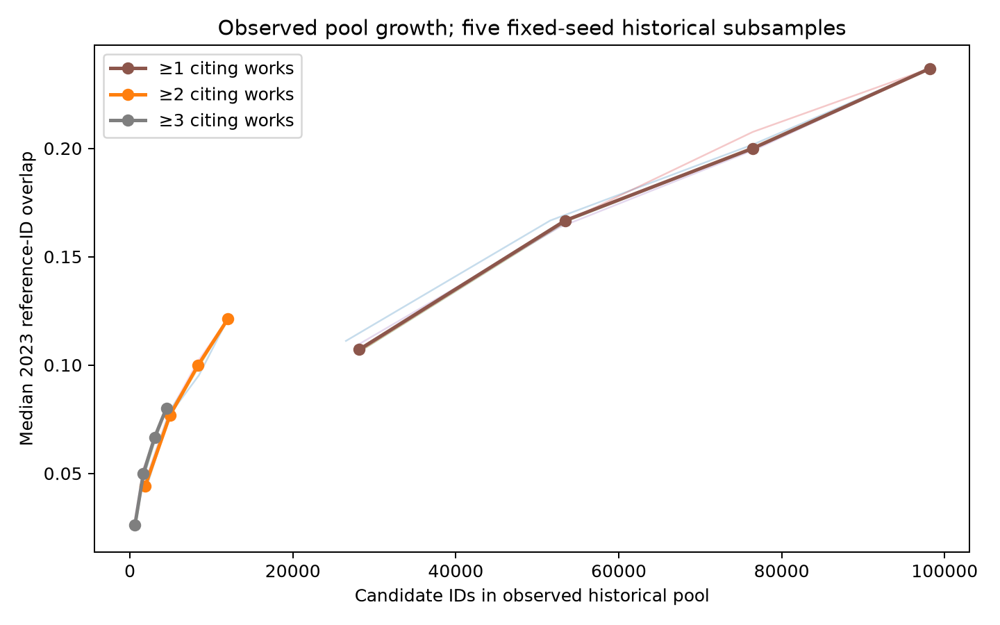

### 5.6 RQ6 — Tính phù hợp của nhãn chủ đề

14 lớp có 3.355 ví dụ huấn luyện đủ điều kiện; 681 ví dụ validation trong danh mục năm 2024 [12]. Các chủ đề gốc chồng lấp, nhất là cặp T10028/T10181. Thiếu abstract phụ thuộc chủ đề; với một số chủ đề đạt hơn 30% trong tập gốc 2020–2024. Việc nhãn OpenAlex và mô hình bất đồng không chứng minh mô hình sai hoặc đúng về mặt ngữ nghĩa. Không có kết quả đánh giá của hai người chấm độc lập; độ đúng của nhãn và ranh giới chủ đề còn mở.

Điểm topic do OpenAlex sinh là tín hiệu phân loại nguồn, không phải mức độ đúng theo chuyên gia. Primary-topic ép bài giao thoa vào một lớp dù secondary topics mô tả thêm khía cạnh. Thiếu abstract theo chủ đề làm giảm tập đủ điều kiện ML không đồng đều, nên support sau lọc không phản ánh prevalence dân số. Cặp T10028/T10181 có nhầm lẫn hai chiều trong validation, tương thích với ranh giới mờ nhưng cần người chấm độc lập để khẳng định [12].

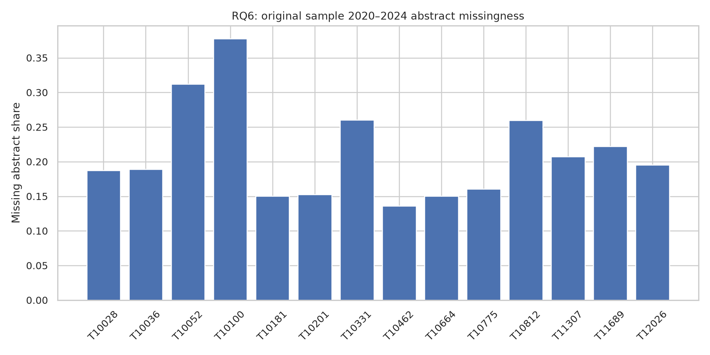

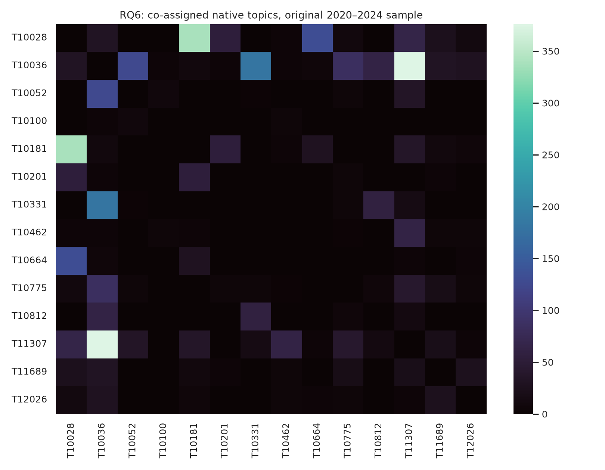

## 6. Phương pháp học máy

Bài toán: từ title và abstract, xếp hạng 14 primary-topic nhãn bạc OpenAlex đã đóng băng. Đầu vào không chứa citation, Work ID, năm, OA hoặc topic score. Dữ liệu lịch sử 2020–2023 gồm 7.002 bài đủ điều kiện; 3.355 bài thuộc 14 chủ đề. 2024 có 1.843 bài gốc đủ điều kiện để phát triển; 681 thuộc danh mục. 2025 có 2.318 bài đủ điều kiện nhưng **không được đọc cho việc chọn mô hình hay báo cáo này** [9].

Baseline gồm lớp chiếm đa số và khớp TF-IDF với mô tả chủ đề. Ba mô hình có giám sát là ComplementNB, Logistic Regression, Linear SVM. Tối ưu tham số bằng `StratifiedGroupKFold` ba fold trên lịch sử, nhóm phiên bản không tách đôi. Macro-F1 trung bình đều theo lớp; accuracy và F1 theo lớp được báo cáo cùng mẫu số. SVM dùng từ đơn/cặp từ TF-IDF, `min_df=2`, tối đa 50.000 đặc trưng, `sublinear_tf=True`, C=1.

Không có lớp OTHER chắc chắn trong danh mục chính. Điểm biên SVM cho phép từ chối/giảm mức tin tưởng dựa trên ngưỡng hiệu chỉnh 2024; điểm biên **không phải xác suất**. Mọi dự đoán đều yêu cầu xác nhận của người dùng. Đánh giá ngữ nghĩa thật cần phiếu mù của hai người chấm và thảo luận bất đồng; hiện chưa có phiếu hoàn tất.

### 6.1 Mục tiêu và phép đo

Với văn bản `x` và nhãn chính OpenAlex `y` trong danh mục 14 chủ đề, bài toán closed-set tìm `f(x)` khớp `y`. Macro-F1 là trung bình F1 từng lớp để giảm sự thống trị của lớp lớn; accuracy là tỷ lệ khớp tổng thể. Với một lớp, `F1 = 2 × precision × recall / (precision + recall)` khi mẫu số xác định. Baseline lớp đa số cho ngưỡng tối thiểu; baseline mô tả topic cho mức khớp từ vựng không giám sát; ba mô hình được giám sát kiểm tra lợi ích nhãn bạc [9].

Trong 3.355 bài huấn luyện thuộc danh mục, 1.717 từ mẫu gốc và 1.638 từ mở rộng có chủ đích. Mở rộng chỉ ở năm lịch sử; cùng 681 bài phát triển 2024 dùng cho so sánh. Mức tăng điểm không chứng minh chọn mẫu bổ sung ngẫu nhiên sẽ cải thiện tương tự. `StratifiedGroupKFold` giữ nhóm phiên bản trong cùng fold; phân hoạch 2024 cho open-set tách calibration và evaluation theo nhóm, song các lựa chọn mô hình vẫn đã quan sát 2024, nên đây là đánh giá phát triển chứ không phải ngoại kiểm độc lập [9].

### 6.2 Quy trình từ chối và xác nhận

Bản thảo ngoài 14 lớp có thể bị ép vào lớp sai nếu chỉ dùng mô hình đóng. Chính sách open-set dùng điểm biên thô và ba trạng thái: gợi ý tương đối rõ, cần xác nhận, không có gợi ý đáng tin. Người dùng có thể duyệt thủ công. Nút xác nhận tách khỏi dự đoán và gắn với title–abstract hiện hành; thay nội dung hủy lựa chọn cũ. Trạng thái “confident” không phải xác suất đúng ngữ nghĩa. Bộ phân loại OTHER tường minh tốt hơn ở một số thước đo phát triển, nhưng chưa được chọn thay thế chính sách đóng băng [9].

## 7. Kết quả thực nghiệm

| Bảng 3. Phương pháp | Macro-F1 trên 681 bài 2024 | Accuracy |
|---|---:|---:|
| Lớp đa số | 0,0248 | 0,2100 |
| Khớp mô tả chủ đề | 0,5522 | 0,5742 |
| ComplementNB, dữ liệu mở rộng | 0,8580 | 0,8532 |
| Logistic Regression, dữ liệu mở rộng | 0,8580 | 0,8649 |
| Linear SVM, chỉ mẫu gốc lịch sử | 0,8506 | — |
| Linear SVM, dữ liệu lịch sử mở rộng | **0,8808** | **0,8796** |

Các giá trị thuộc cùng tập validation 681 bài trong danh mục, ngoại trừ đối chiếu mở rộng/chỉ-gốc dùng cùng tập 2024 nhưng hai tập huấn luyện khác nhau [9]. Khoảng bootstrap ghép cặp 500 lần cho hiệu macro-F1 SVM mở rộng trừ chỉ-gốc là [0,0084; 0,0527]; đây không phải độ bất định của nhãn bạc hay quá trình lấy mẫu tổng thể. 82/681 dự đoán SVM không trùng nhãn chính OpenAlex; 48/82 nhãn dự đoán xuất hiện ở chủ đề thứ cấp, một dấu hiệu mơ hồ chứ không xác nhận đúng.

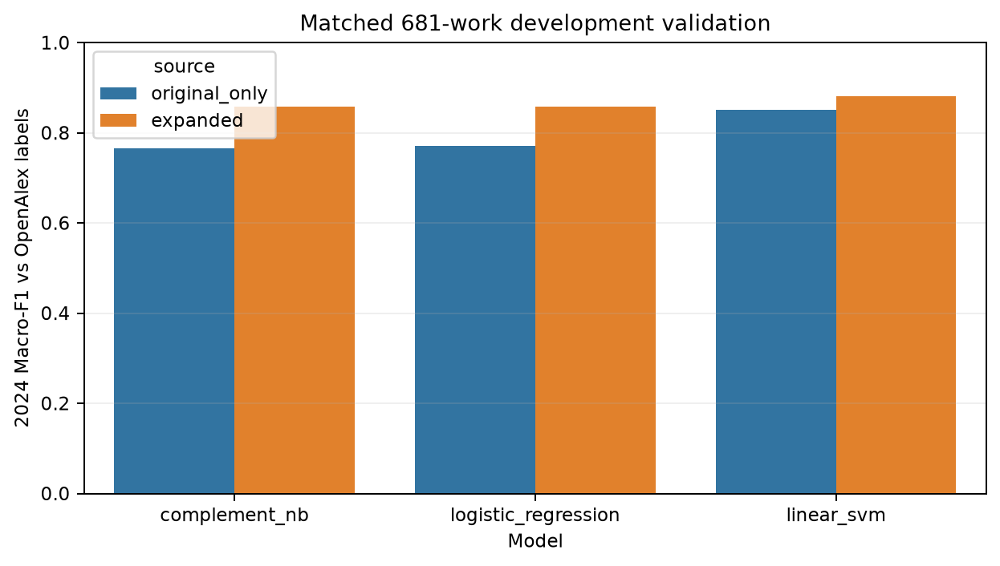

Đánh giá open-set phát triển chia theo nhóm phiên bản: 738 bài hiệu chỉnh và 1.105 bài kiểm tra nội bộ (408 trong danh mục, 697 ngoài). Ngưỡng biên cố định −0,22227267687798036 đặt để giới hạn chấp nhận nhầm ngoài danh mục ≤20% trên hiệu chỉnh. Trên nhóm kiểm tra nội bộ, chấp nhận đúng phạm vi 83,09%, chấp nhận nhầm ngoài danh mục **21,66%**, AUROC 0,8919, tỷ lệ chấp nhận đúng chủ đề / mọi bài đủ điều kiện **28,33%** [9]. Mục tiêu 20% không đạt trên đánh giá phát triển. Tập kiểm thử 2025 vẫn **SEALED**, không có metric cuối cùng.

### 7.1 Sai số theo lớp và ma trận nhầm lẫn

Macro-F1 0,8808 không bảo đảm đồng đều: T10181 có 36 bài validation và F1 0,7042; T10028 có 84 bài, F1 0,8000; T10331 có 22 bài, F1 0,8182 [9]. Những mẫu số nhỏ làm ước lượng theo lớp dao động mạnh. Trong 82/681 trường hợp không trùng nhãn chính, 48 nhãn dự đoán có mặt trong danh sách chủ đề phụ. Dấu hiệu này phù hợp với chồng lắp chủ đề, nhưng không thể chấm mô hình đúng chỉ vì nhãn phụ có mặt. Ma trận nhầm lẫn cũng có lỗi hướng hai chiều T10181↔T10028 (7 mỗi chiều), một cặp cần ưu tiên cho chấm ngữ nghĩa độc lập.

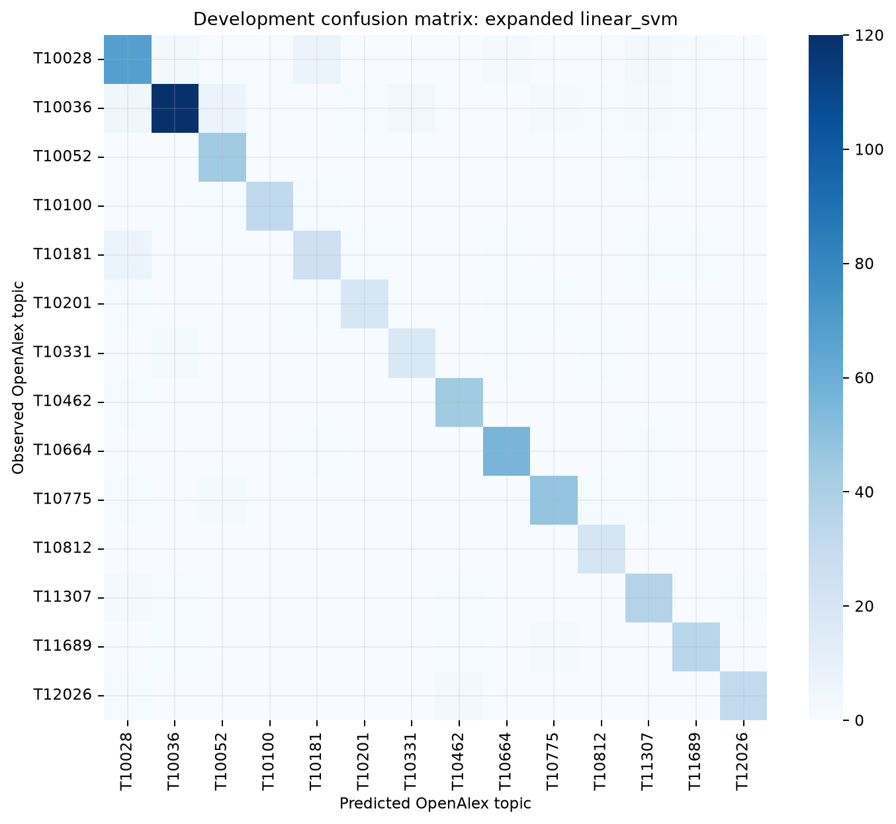

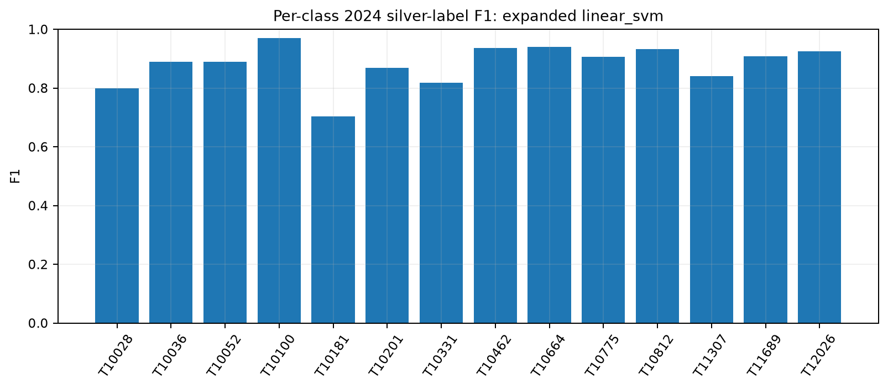

### 7.2 Mở rộng dữ liệu và bất định

SVM chỉ mẫu lịch sử gốc đạt macro-F1 0,8506, SVM huấn luyện trên tập mở rộng đạt 0,8808, chênh 0,0302 trên **cùng** 681 bài phát triển. So sánh cố định C=1 cho 0,8501 so với 0,8808, cô lập thay đổi tập huấn luyện tốt hơn so với đối chiếu có tuning riêng. Khoảng bootstrap ghép cặp 500 lần [0,0084; 0,0527] cho hiệu chênh không tính sai số nhãn bạc, sai số lấy mẫu API hay biến động do đợt thu thập mới. Trên đường học, thêm 548 bài đưa điểm lên 0,8773, thêm 1.090 bài lại còn 0,8708, rồi toàn bộ 1.638 đạt 0,8808; do đó không thể khẳng định mỗi lô mở rộng đều giúp [9].

### 7.3 Phân tích open-set

Ngưỡng được chọn từ 738 bài calibration để nhắm tỷ lệ nhận nhầm ngoài danh mục không quá 20%. Khi áp dụng cố định cho 1.105 bài đánh giá nội bộ, kết quả 21,66% vượt mục tiêu; khoảng bootstrap xấp xỉ [18,8%; 24,6%] chứa cả vùng trên mức mục tiêu. AUROC 0,8919 mô tả khả năng xếp hạng trong/ngoài danh mục qua mọi ngưỡng, không bảo đảm ngưỡng thực tế an toàn. Tỷ lệ 28,33% là số bài được chấp nhận **và** gán đúng nhãn bạc chia cho toàn bộ 1.105 bài, không phải accuracy trên các bài đã chấp nhận. Bộ OTHER dùng Logistic Regression có một số chỉ số tốt hơn nhưng là phân tích thăm dò, không làm thay đổi bundle đã đóng băng. Mô hình được giữ ở chế độ hỗ trợ có xác nhận [9].

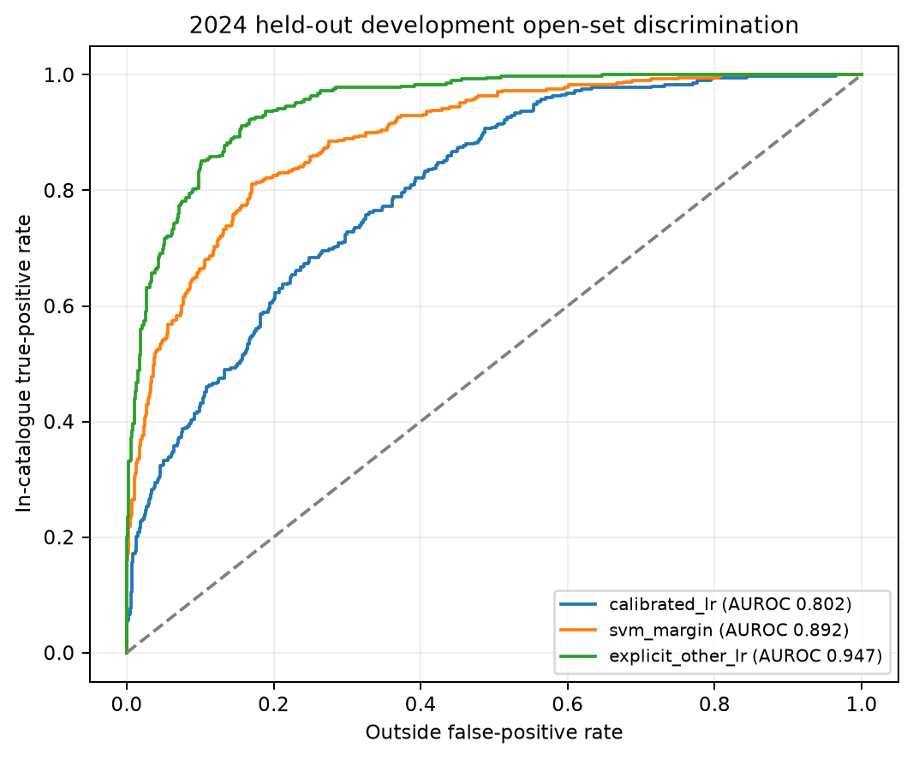

## 8. Thiết kế và triển khai hệ thống

Giao diện dùng Streamlit và Plotly trên dữ liệu cục bộ đã được xác minh. Lớp `ResearchData` cung cấp tổng quan, xu hướng, Topic Brief, tìm kiếm 12.000 giấy tờ và thống kê OA/trích dẫn/hợp tác. Sáu trang: Home, Research Landscape, Topic Explorer, Classify My Research, Paper Explorer, Methodology & Model Evaluation. Topic Explorer duyệt trực tiếp qua dữ liệu, không tải mô hình. Chỉ trang phân loại mới nạp bundle SVM có kiểm tra checksum, giới hạn input và trả top ba nhãn cùng trạng thái `confident_suggestion`, `needs_user_confirmation` hoặc `no_confident_match`. Chọn chủ đề là hành động riêng của người dùng, lưu trong phiên web chứ không sửa nguồn OpenAlex.

Mô hình `joblib` chỉ được tải từ gói đáng tin cậy đã được đối chiếu manifest; checksum không biến một pickle không tin cậy thành an toàn. Tên bài từ OpenAlex được hiển thị dưới dạng văn bản, không chèn HTML thô. Ứng dụng không gửi API trong vận hành thông thường. Trang reviewer riêng chỉ cho localhost, tách reviewer A/B và không hiện nhãn thật/dự đoán. Khóa kiểm thử 2025 dùng cổng phê duyệt sẵn có cộng registry tạo độc quyền; registry chỉ là biện pháp kỹ thuật tại một máy, không thay thế quản trị dự án hoặc ngăn clone khác.

### 8.1 Hợp đồng dữ liệu và đường đi của một yêu cầu

Nguồn của Research Landscape là gói chỉ đọc gồm bảng tổng thể, thống kê mẫu gốc và hình đã xác minh. Topic Explorer dùng catalogue 14 chủ đề cùng Topic Brief chuẩn bị trước; Paper Explorer lập chỉ mục **chỉ** 12.000 bài mẫu, có phân trang và lọc. Lượt phân loại khác: sau kiểm tra độ dài và văn bản, service tải bundle trusted, tạo top ba với điểm biên, gắn trạng thái open-set, cho phép chọn thủ công và chỉ sau đó mở Topic Brief. Sửa input hủy dự đoán/xác nhận liên quan để tránh hiển thị kết quả cũ như hiện hành. Giao diện không tự điền nhãn vào dữ liệu nghiên cứu và không dùng bản thảo người dùng để huấn luyện lại.

### 8.2 Kiến trúc triển khai và an toàn

Thiết kế chạy cục bộ trên Ubuntu: trình duyệt → Streamlit → lớp truy vấn dữ liệu/serving model → gói dữ liệu và model đã có manifest. Không có dịch vụ OpenAlex trực tuyến trong đường đi suy luận; việc lấy dữ liệu là một quy trình tách biệt. Bundle pickle/joblib chỉ được tải từ nguồn do nhóm kiểm soát; SHA-256 bảo vệ tính toàn vẹn với manifest đáng tin nhưng không bảo vệ khỏi mã độc nếu cả bundle và manifest đều từ nguồn không tin. Kho GitHub không chứa raw abstract hoặc model nhị phân. Bản clone sạch cần được cấp riêng các artifact hợp lệ và xác minh checksum; vì vậy khả năng chạy demo cục bộ khác với khả năng triển khai công khai.

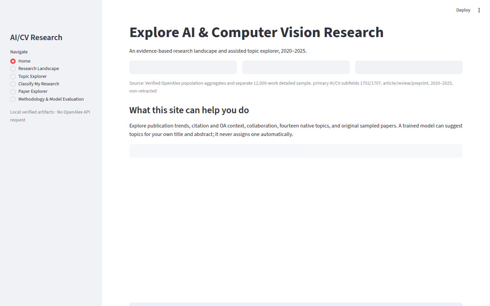

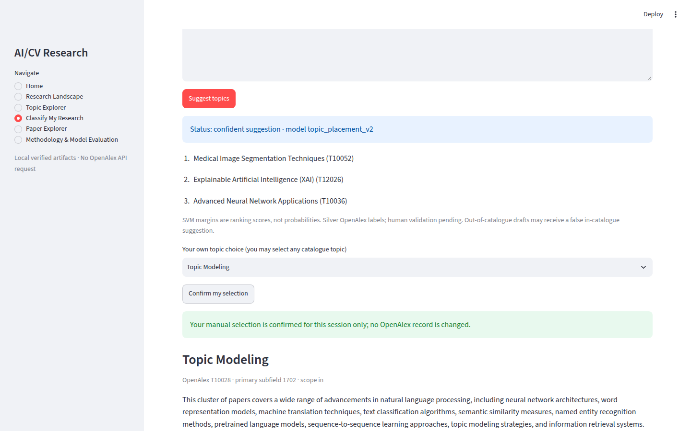

## 9. Kiểm thử và đánh giá hệ thống

Các bài kiểm thử ngoại tuyến kiểm tra API, chuẩn hóa, tính toàn vẹn bảng, phương pháp, huấn luyện và phần web. Kiểm tra UI dùng Streamlit AppTest cho Home; kiểm tra service yêu cầu xác nhận và duyệt Topic Brief không nạp mô hình. Gói web và model được verifier đọc trước khi chạy; tài liệu triển khai chứa lệnh khởi chạy và kiểm tra HTTP health. Kết quả chạy cuối, phiên bản phụ thuộc và giới hạn thử nghiệm được ghi tại `reports/FINALIZATION_P4_TESTING_REPORT.md`; không khẳng định có người dùng tham gia thử nghiệm nếu chưa có dữ liệu thực.

### 9.1 Phạm vi kiểm thử và chứng cứ hồi quy

Các bài kiểm thử đơn vị kiểm tra chuẩn hóa ID, bộ lọc, nhóm phiên bản, chỉ số và các hợp đồng UI. Kiểm thử tích hợp dùng artifact cục bộ có checksum để phát hiện sai khác giữa đường đi phân tích và đường đi giao diện. Browser E2E dùng Chrome/Playwright truy cập Streamlit thật, kiểm tra dự đoán → top ba → chọn thủ công → xác nhận → Topic Brief, thay đổi input, các trang nghiên cứu, tải báo cáo và trạng thái không kết quả. Ảnh chụp ở desktop/laptop/tablet/mobile là bằng chứng bố cục, không thay thế đánh giá khả dụng của người thật. Các bộ dữ liệu/mô hình local Git-ignored không có trên CI của bản clone sạch, nên kết quả CI ngoại tuyến không phải chứng nhận chạy end-to-end đầy đủ.

Kiểm toán độc lập đã phát hiện lỗi xác nhận chủ đề vì UI đọc khóa tên không có trong hợp đồng topic, gợi ý cũ vẫn có thể xuất hiện sau khi đổi input, liên kết báo cáo tương đối sai, và phần Methodology quá ngắn. Bản sửa thay bằng trường `official_name`, fingerprint nội dung, nút tải DOCX/PDF và nội dung RQ1–RQ6 có provenance. Mỗi lỗi có kiểm thử hồi quy tương ứng; bảng trạng thái và kết quả chạy thực tế nằm trong báo cáo khắc phục Phase 4.1. Chưa có khảo sát người dùng hoặc đánh giá hai người chấm, nên bài kiểm thử kỹ thuật không được gọi là thẩm định khoa học.

## 10. Thảo luận và hạn chế

Thiết kế lấy mẫu qua API không bảo đảm xác suất chọn. Thiếu abstract làm giới hạn cả phân loại từ ngữ và phân tích nhãn; thiếu FWCI ở tất cả preprint làm so sánh chỉ dựa vào subset. DOI/affiliation thiếu, độ tuổi bài, thay đổi OpenAlex và chủ đề chồng lắp khiến kết luận chỉ mang tính mô tả. Mô hình mục tiêu là sự tương hợp với nhãn bạc, không phải tri thức chủ đề do chuyên gia xác lập. Tỷ lệ chấp nhận nhầm ngoài danh mục 21,66% là rủi ro sử dụng quan trọng; ứng dụng phải hiển thị sự dè dặt. Phân tích OA là quan sát, không nhận dạng tác động nhân quả. Website cục bộ có giá trị giáo dục và hỗ trợ khám phá, chưa có chứng cứ sử dụng thực tế rộng rãi hay khả năng vận hành công khai với gói dữ liệu/model Git-ignored.

Tập 2025 được bảo vệ theo giao thức đóng băng và chỉ có thể mở một lần sau khi nhận hai đánh giá độc lập, quyết định phạm vi, xác nhận checksum và phê duyệt rõ ràng. Mô hình cuối hiện tại là bundle lịch sử 2020–2023; không âm thầm thay bằng mô hình được fit thêm 2024. Registry cục bộ không thể ngăn một clone trái phép mở tập khác; trách nhiệm quản trị và kiểm toán vẫn thiết yếu.

### 10.1 Giá trị thực tiễn so với giới hạn chứng cứ

Giá trị rõ nhất là cung cấp một chuỗi bằng chứng minh bạch: người dùng thấy số đếm tổng thể khác với bối cảnh mẫu, đọc các nghiên cứu có thật, nhận gợi ý chủ đề nhưng có quyền từ chối. Kết quả ML 2024 chứng minh khả năng tái tạo nhãn OpenAlex trong phạm vi 14 chủ đề ở một tập phát triển, không chứng minh bản thảo mới được đặt đúng theo chuyên gia. Chưa có đo lường thời gian người dùng tiết kiệm, mức hài lòng, sai lệch theo ngôn ngữ, hoặc mức phù hợp của Topic Brief với nhu cầu thật. Việc mở rộng sang triển khai công khai đòi xem xét quyền chia sẻ artifact, bảo mật lưu trữ bản thảo nhập, và quy trình phân phối model/dữ liệu; không nên suy ra các thuộc tính đó từ demo cục bộ.

### 10.2 Công việc khoa học còn mở

Ưu tiên tiếp theo là hai người đánh giá độc lập chấm bộ ví dụ mù đã chuẩn bị, đối chiếu bất đồng và xác định tiêu chí chủ đề ngoài danh mục. Sau khi giao thức phạm vi và ngưỡng được phê duyệt, mới có thể xem xét cổng kiểm thử 2025 một lần; không mở tập chỉ để tối ưu thêm. Một phân tích nhạy cảm về thay đổi taxonomy, thiếu abstract và tách loại công trình sẽ làm rõ hơn độ bền của kết quả. Đối với OA, muốn suy luận nhân quả cần thiết kế bổ sung ngoài phạm vi dự án quan sát hiện tại.

## 11. Kết luận

Dự án hoàn tất một chuỗi nghiên cứu Khoa học dữ liệu có phân định dân số–mẫu, kiểm tra nguồn và báo cáo phương pháp. Dữ liệu OpenAlex cho thấy xu hướng tăng mạnh trong khung AI/CV đã định nghĩa; phân tích trích dẫn/OA/hợp tác đòi hỏi xét tuổi bài, thiếu dữ liệu và thành phần nhóm. Hệ ML SVM có độ khớp tốt với nhãn bạc trên phát triển 2024 nhưng chưa đủ căn cứ cho gán nhãn tự động. Kết quả phù hợp nhất là **nguyên mẫu hỗ trợ người dùng, có thể duyệt chủ đề thủ công và xác nhận gợi ý**, trong khi đánh giá người thật và bài kiểm thử 2025 vẫn là việc cần thực hiện trước khi tuyên bố khả năng tổng quát cuối cùng.

## Phụ lục A — Lệnh tái tạo cục bộ

```bash
python -m venv .venv
source .venv/bin/activate
pip install -e ".[dev,web,deliverables]"
openalex-build-web-data verify data/analysis/finalization_p2_web_data_20261101_v3
openalex-verify-final-ml data/analysis/finalization_p3_models_20261101_v1
streamlit run dashboard/app.py --server.address 127.0.0.1
pytest -q -ra
```

Không tải dữ liệu/mô hình từ GitHub vì các artifact này được loại khỏi Git; xem manifest và hướng dẫn tái tạo riêng. Không chạy `openalex-final-test` khi chưa có xác nhận chính thức.

## Phụ lục B — Từ điển dữ liệu rút gọn

`works` một dòng/Work ID; `work_topics`, `work_institutions`, `work_countries`, `references` là quan hệ nhiều-nhiều không nhân bản số bài; `category_membership` tách native/custom; `population_year_counts` chỉ từ tổng hợp đã xác minh; `paper_index` chỉ gồm 12.000 bài mẫu gốc. Các cột dẫn xuất `log1p_citations`, `has_fwci`, `international_collaboration` phải giữ null/unknown thích hợp [10].

## Phụ lục C — Ma trận nguồn dữ liệu và khả năng suy luận

| Bảng 4. Thành phần | Nguồn quan sát | Đơn vị / mẫu số | Có thể suy luận | Không thể suy luận |
|---|---|---|---|---|
| RQ1 tổng thể | Aggregate API đã xác minh | Work ID trong khung AI/CV | Số bản ghi theo năm tại snapshot | Tăng trưởng của mọi nghiên cứu AI toàn cầu |
| RQ2 trích dẫn | Mẫu gốc 12.000 | Work ID có trường trích dẫn | Phân phối trong mẫu và phân nhóm quan sát | Chất lượng khoa học từng công trình |
| RQ3 OA | Mẫu gốc 12.000 | Work ID có trường OA/covariate | Liên hệ có điều kiện trên thang log | Tác động nhân quả của OA |
| RQ4 hợp tác | Mẫu gốc, subset có affiliation | Work ID có quốc gia/tổ chức đủ dữ liệu | Đồng liên kết trong subset | Quốc tịch hay toàn mạng hợp tác |
| RQ5 tham khảo | Cạnh quan sát từ mẫu gốc | Work ID và cạnh tham khảo | ID-overlap theo cutoff | Độ phù hợp của tài liệu chưa được dẫn |
| RQ6 nhãn | OpenAlex + văn bản đủ điều kiện | Topic chính và bản thảo | Độ khớp với nhãn bạc | Độ đúng ngữ nghĩa do chuyên gia |
| ML dev 2024 | Mẫu gốc, nhóm phiên bản tách | 681 closed-set; 1.105 open-set | Chỉ số phát triển có điều kiện | Hiệu quả cuối cùng trên 2025 |

Ma trận trên là ranh giới tối thiểu khi trình bày kết quả. Mẫu gốc dùng cho bối cảnh chi tiết; tập mở rộng nhắm lớp chỉ được đưa vào train, không vào xu hướng hay RQ2–RQ4. Các số đếm thiếu dữ liệu là một phần của định nghĩa mẫu số. Ví dụ, hợp tác quốc tế dùng 7.970 bài có trạng thái xác lập; nếu thay bằng 12.000, tỷ lệ sẽ mô tả một đại lượng khác. Tương tự, 681 bài validation trong danh mục không được thay bằng 1.843 bài 2024 đủ điều kiện tổng thể khi báo cáo macro-F1 closed-set. Việc ghi rõ đơn vị phân tích giúp tránh sai số do phép nối nhiều-nhiều giữa `works` với `authorships` hoặc `topics` [8]–[12].

## Phụ lục D — Quy trình đánh giá mô hình và các kiểm soát rò rỉ

Giai đoạn xây nhãn bắt đầu từ một danh mục 14 ID chủ đề OpenAlex được đóng băng. Với mỗi Work ID, chỉ primary topic làm nhãn mục tiêu; topic phụ được giữ cho kiểm toán mơ hồ, không phải nhãn huấn luyện. Các bài thiếu văn bản hoặc thuộc ngoài danh mục không biến mất khỏi audit gốc: chúng được ghi trong mẫu số đủ điều kiện hoặc nhóm ngoài danh mục. Nhóm phiên bản xác định trước khi chia fold để bài gần trùng không nằm cả train lẫn validation. Quy tắc này giảm một loại rò rỉ phổ biến, nhưng không chứng minh không có cặp gần trùng không được phát hiện.

Đối với closed-set, bước chọn đặc trưng gồm title và abstract đã làm sạch, nối theo cấu hình cố định. Việc viết hoa và Unicode của văn bản nguồn được bảo tồn ở bảng dữ liệu; tokenizer TF-IDF chuẩn hóa phục vụ riêng mô hình. Từ vựng và IDF chỉ được học trên fold huấn luyện; sau đó cùng vectorizer biến đổi fold validation. Ba fold `StratifiedGroupKFold` kết hợp bảo toàn tương đối tỷ lệ lớp và cách ly nhóm phiên bản. Grid tham số của ComplementNB là alpha 0,5/1/2; Logistic Regression và Linear SVM thử C 0,3/1/3. Siêu tham số cuối C=1 của SVM đến từ lịch sử, còn 2024 dùng để đối chiếu lựa chọn với baseline và xem lỗi [9].

Đánh giá 2024 gồm hai mục đích khác nhau. Closed-set giữ 681 bài trong danh mục, báo cáo macro-F1, accuracy, F1 theo lớp và ma trận nhầm lẫn. Open-set dùng 1.843 bài đủ điều kiện 2024, tách theo nhóm thành 738 calibration và 1.105 evaluation; 697/1.105 bài evaluation nằm ngoài danh mục. Ngưỡng biên được chọn trên calibration để hướng tới nhận nhầm ngoài danh mục không quá 20%. Sau khi đóng băng ngưỡng, tỷ lệ 21,66% trên evaluation là một lỗi so với mục tiêu, không phải một phép “pass” vì AUROC cao. Có thể lập biểu đồ trade-off theo ngưỡng nhưng không được tinh chỉnh ngưỡng trên evaluation rồi báo chính tập đó như kiểm chứng độc lập.

Bootstrap ghép cặp giữ nguyên từng bài validation qua hai mô hình để ước lượng sự dao động của chênh macro-F1 trên tập 2024 đã quan sát. Khoảng [0,0084; 0,0527] không bao hàm bất định của việc chọn danh mục 14 chủ đề, dữ liệu OpenAlex thay đổi, nhãn sai, hoặc một lứa bài 2025 khác. Con số này giúp đánh giá liệu thêm dữ liệu lịch sử có cải thiện trên cùng validation hay không, chứ không phải xác suất rằng mở rộng luôn hữu ích trong tương lai. Trước khi mở 2025, nhóm phải hoàn thành chấm người thật, quyết định phạm vi và phê duyệt giao thức; hiện mọi phép đo trên 2025 vẫn bị cấm.

## Phụ lục E — Tiêu chuẩn nghiệm thu giao diện và tái lập

Một bản clone có mã nguồn nhưng không có các artifact Git-ignored không thể tự động chạy toàn bộ ứng dụng. Để dựng demo cục bộ, cần bundle SVM, gói web-data, các manifest và checksum tương ứng từ nguồn được phép; sau khi đặt vào đường dẫn đã tài liệu hóa phải chạy verifier. Artifact `joblib` chỉ nên được tải từ nguồn nhóm kiểm soát vì quá trình giải tuần tự hóa có thể thực thi mã. Gói dữ liệu web chứa chỉ mục 12.000 bài gốc và Topic Brief của 14 chủ đề; nó không là bản sao toàn bộ raw OpenAlex và không chứa huấn luyện mở rộng để trình bày prevalence. Bộ ảnh công khai trong báo cáo được lấy từ Chrome thực với bản thảo trình diễn không nhạy cảm; ảnh chụp đầy đủ ở bốn viewport lưu cục bộ, không đưa riêng tư lên Git.

Đường đi kiểm thử quan trọng gồm: truy cập Home; kiểm tra RQ1–RQ6; duyệt Topic Explorer khi model không nạp; tìm và lọc Paper Explorer; nhập bản thảo hợp lệ; quan sát top ba; chọn thủ công; xác nhận; đổi title hoặc abstract; xác nhận cũ phải biến mất; thử trường hợp không có kết quả; mở trang Methodology và tải báo cáo. Browser E2E kiểm tra chức năng bằng Chrome, còn AppTest kiểm tra hợp đồng widget/state ở mức Streamlit. Hai tầng này bổ sung nhau: AppTest không nhìn thấy bọc chữ, tràn màn hình hoặc liên kết tải thực; browser không thay thế kiểm toán giá trị nguồn và manifest. Ảnh chụp điện thoại phải đọc được chữ và nút, không chỉ có ảnh “đã chụp”.

Các cổng khoa học độc lập với UI gồm: xác minh checksum trang raw Phase 2, tám bảng Parquet Phase 3, 64 artifact Phase 4, gói RQ6, gói web-data, bundle model, và tình trạng sealed của 2025. Một giao diện chạy được không chứng minh các chuỗi này đúng; ngược lại checksum hợp lệ không chứng minh điều khiển web dễ dùng. `pytest` trên CI công khai chạy các kiểm thử không cần artifact riêng; các bài tích hợp thật và browser có điều kiện phải chạy trên máy có gói đã được cấp. Quy trình này tránh đưa raw abstract, model binary hoặc file đánh giá con người lên repository chỉ để làm CI xanh.

## Tài liệu tham khảo (IEEE)

[1] J. Priem, H. Piwowar, R. Orr, “OpenAlex: A fully-open index of scholarly works, authors, venues, institutions, and concepts,” 2022. https://arxiv.org/abs/2205.01833

[2] OpenAlex, “Works overview,” tài liệu chính thức, truy cập 01/11/2026. https://help.openalex.org/data/works/

[3] OpenAlex, “Topics – Aboutness,” tài liệu chính thức, truy cập 01/11/2026. https://help.openalex.org/data/topics/

[4] G. Salton, C. Buckley, “Term-weighting approaches in automatic text retrieval,” *Information Processing & Management*, vol. 24, no. 5, pp. 513–523, 1988. https://doi.org/10.1016/0306-4573(88)90021-0

[5] scikit-learn, “TfidfVectorizer,” tài liệu chính thức. https://scikit-learn.org/stable/modules/generated/sklearn.feature_extraction.text.TfidfVectorizer.html

[6] scikit-learn, “LinearSVC,” tài liệu chính thức. https://scikit-learn.org/stable/modules/generated/sklearn.svm.LinearSVC.html

[7] Dự án, `reports/PHASE5_FINAL_DECISION.md` và `reports/PHASE5_REFERENCE_EDA_REPORT.md`, phiên bản repository này.

[8] Dự án, `reports/PHASE2_COLLECTION_REPORT.md` và manifest thu thập đã kiểm chứng, phiên bản repository này.

[9] Dự án, `reports/FINALIZATION_P3_FINAL_ML_REPORT.md`, `FINALIZATION_P3_OPEN_SET_EVALUATION.md`, phiên bản repository này.

[10] Dự án, `docs/DATA_DICTIONARY.md` và `docs/FINALIZATION_P2_WEB_DATA_CONTRACT.md`, phiên bản repository này.

[11] Dự án, `reports/PHASE4_ANALYSIS_REPORT.md` và gói dữ liệu web Phase 2 cuối, phiên bản repository này.

[12] Dự án, `reports/FINALIZATION_P2_RQ6_TOPIC_LABEL_ANALYSIS.md`, phiên bản repository này.
