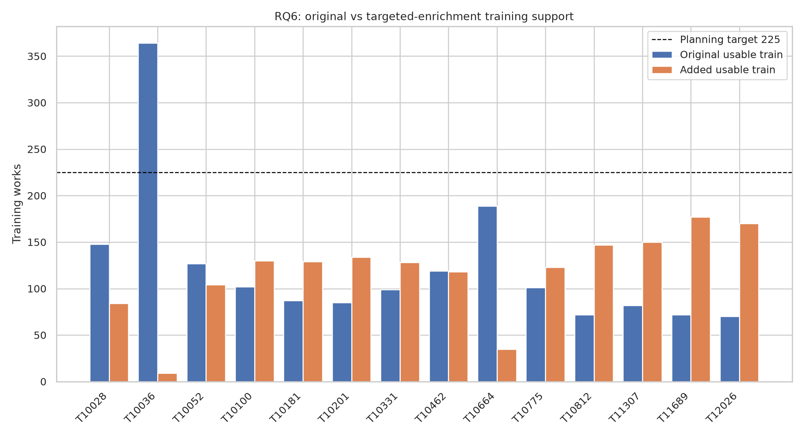
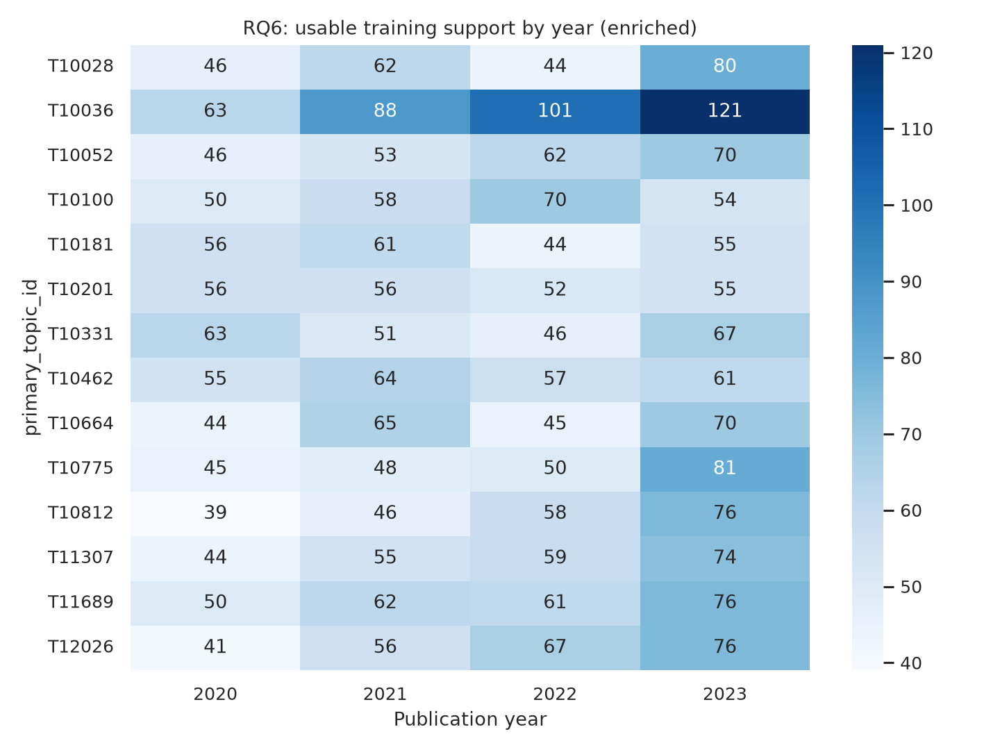
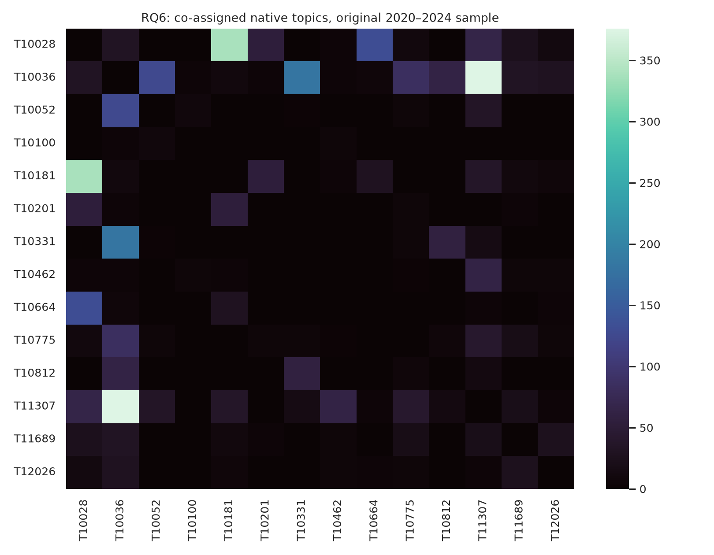
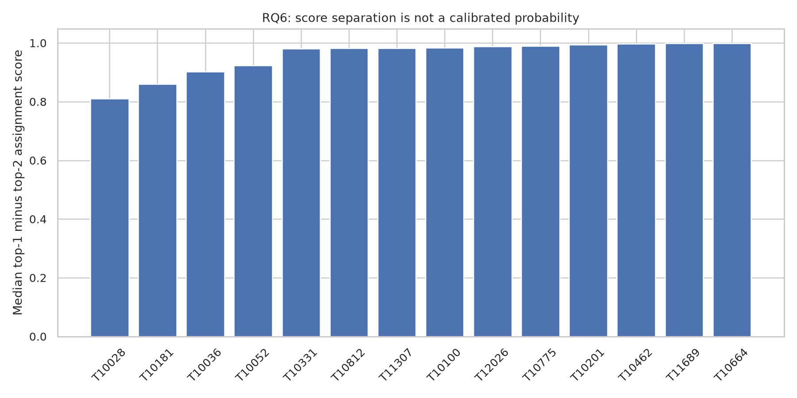
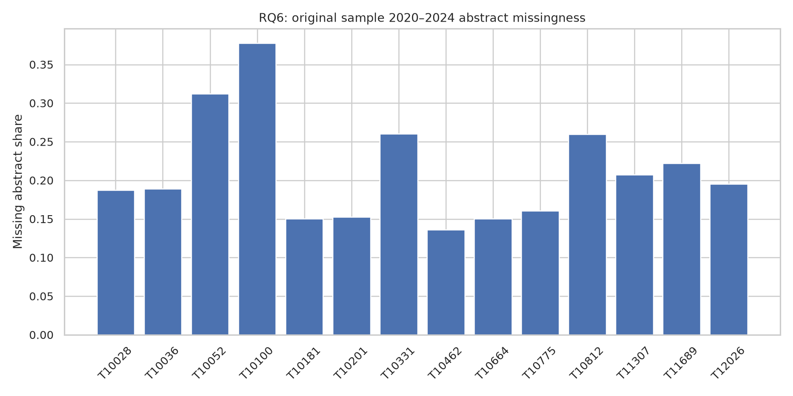

# RQ6 — OpenAlex topic-label feasibility and semantic audit

RQ6 asks whether the 14 frozen OpenAlex primary-topic labels provide a defensible, clearly qualified supervised topic-placement task. This is an audit of **silver labels**, not an estimate of true topic accuracy. All paper-level comparisons use original 2020–2024 records or 2020–2023 integrated training data; 2025 labels are not analyzed. Eight audited CSV tables and five figures are in [`reports/finalization_p2/`](finalization_p2/manifest.json); the local source run is `data/analysis/finalization_p2_rq6_20261101_v3/`. The RQ6 verifier checked all 13 published files against source SHA-256.

## Support, imbalance and time

The 14 selected classes have 3,355 usable integrated training examples and 681 usable 2024 validation examples. Training support ranges from 216 (T10181) to 373 (T10036). Five classes are below the 225-row planning heuristic: T10181 216 (gap 9), T10201 219 (6), T10664 224 (1), T10775 224 (1), and T10812 219 (6). The combined shortfall is 23. Year-by-topic counts are available in the published `topic_year_train.csv`; these are **training-set counts**, not population trends. The training expansion changes class composition deliberately.

## Overlap and topic-score diagnostics

The original sample's OpenAlex top-three topic assignments overlap. T10036/T11307 co-occur on 376 works; T10028/T10181 on 338. For the latter pair, 49.1% of T10028 top-three memberships also carry T10181 and 78.2% of T10181 memberships carry T10028. These conditional proportions use different denominators and should not be read as pairwise label error rates. Official-description TF-IDF cosine is highest for T10775/T11307 (0.181) and T10028/T10181 (0.165); short-description lexical similarity is only a prioritization cue for human audit. OpenAlex topic scores and top-one/top-two gaps are classifier outputs, not calibrated probabilities or scientific quality. The published score table reports per-class median gaps and the fraction with gap <0.05.

## Text completeness and interpretation

Among original 2020–2024 works with selected primary topics, missing abstracts are topic-dependent: T10100 37.8%, T10052 31.2%, T10331 26.0%, and T10812 26.0%. The report tables include Wilson 95% intervals by topic and missingness by work type. A missing abstract is not evidence that the topic assignment is wrong; it restricts what a later title/abstract model can learn and limits any lexical audit. Malformed or short text is kept in the source audit rather than silently dropped from provenance.

The 14 topic definitions have plausible overlap, especially broad NLP and CV clusters. The frozen catalogue was selected before these new 2025 aggregate requests and is unchanged. Population-level topic counts are provided as a **separate** primary-topic OpenAlex snapshot, not inferred from the targeted training set. A reliable independent semantic-validity conclusion remains blocked by zero completed human reviews.
