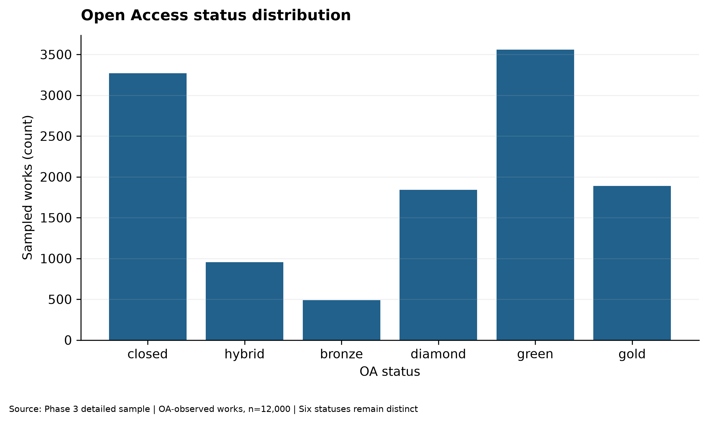

# Phase 4: Exploratory and Statistical Analysis Report

## 1. Executive summary

The approved OpenAlex AI/CV primary-subfield population contains **937,493 non-retracted works** across 2020–2025. Annual volume rose from **125,506** to **232,476** (13.12% five-interval CAGR). These are complete-query aggregate counts, not sample estimates.
The detailed 12,000-work sample has a median of **2** observed citations versus a mean of **11.24**, highlighting skew. FWCI is observed for **9,322** articles/reviews and no sampled preprints.
OA-status associations are conditional, observational results; the primary model retains **12,000** works. International collaboration is explicitly unknown for **4,030** works. None of these findings establishes causal impact or a global AI network.

## 2. Research scope and methodology

The corpus consists of OpenAlex articles, reviews and preprints dated 2020-01-01 through 2025-12-31 whose **primary** topic belongs to subfield 1702 or 1707. Retracted works are excluded from the primary series. It is not all worldwide AI research. The complete population aggregates are analyzed separately from a fixed-seed, year-stratified 12,000-work detailed sample. OpenAlex server-side sampling is not verified as a known-probability design; nominal `N_h/n_h` weights are not used to claim population-unbiased estimates or design-based intervals.
Source run: `stratified_20261019T155909Z`; common citation observation time: `2026-10-19T16:03:40Z`; Phase 3 manifest SHA-256: `5d21e6187f0cf569b284ea399ffff02cb02d29d1e936a5fa716c7c96758de19c`; analysis seed: `20261023`. All work-level joins preserve the unique Work ID grain. Missing values remain null and are excluded only from analyses requiring that field. The predeclared [statistical analysis plan](../docs/PHASE4_STATISTICAL_ANALYSIS_PLAN.md) defines methods and model families before result interpretation.

## 3. RQ1 — Publication and topic trends

| Year | Population works | Absolute YoY | YoY % | 2020 index |
|---:|---:|---:|---:|---:|
| 2020 | 125,506 | — | — | 100.0 |
| 2021 | 128,893 | +3,387 | +2.70% | 102.7 |
| 2022 | 126,189 | -2,704 | -2.10% | 100.5 |
| 2023 | 145,735 | +19,546 | +15.49% | 116.1 |
| 2024 | 178,694 | +32,959 | +22.62% | 142.4 |
| 2025 | 232,476 | +53,782 | +30.10% | 185.2 |

Across the five intervals, total change is **+106,970 works** (85.23%). No 2020 YoY rate is reported because there is no 2019 baseline.

Selected OpenAlex-native topic series (membership overlaps):

| Native series | 2020 count | 2025 count | 2025 share of primary corpus |
|---|---:|---:|---:|
| computer_vision | 14,698 | 37,232 | 16.02% |
| explainable_ai | 1,539 | 6,338 | 2.73% |
| multimodal_machine_learning_applications | 1,800 | 12,971 | 5.58% |
| natural_language_processing | 10,302 | 28,449 | 12.24% |
| reinforcement_learning | 3,665 | 8,224 | 3.54% |

*Figure RQ1. Annual publication counts from complete OpenAlex population aggregates, not the 12,000-work sample.*

The native series share the approved primary-corpus and non-retraction filters. Their memberships overlap, so their counts cannot be summed into an AI total. Classification or database changes can affect apparent growth.

Custom title/abstract matches in the detailed sample (exploratory, not population counts):

| Text-rule category | Matched sampled works | 2025 matches | 2025 sample denominator |
|---|---:|---:|---:|
| large_language_models | 526 | 301 | 2,976 |
| multimodal_ai | 165 | 94 | 2,976 |
| retrieval_augmented_generation | 39 | 25 | 2,976 |

The RAG rule identifies few works and has unmeasured recall; no RAG population trajectory is inferred. Abstract availability by year is included in the machine-readable table. Supporting RQ1 figures: [population YoY](figures/phase4/rq1_yoy_growth.png), [population index](figures/phase4/rq1_population_index.png), [overlapping native-topic population series](figures/phase4/rq1_native_topic_trends.png), [sample text-rule matches](figures/phase4/rq1_emerging_sample_trends.png).

## 4. RQ2 — Citation impact

Observed citation counts: n=12,000; mean 11.24; median 2.00; IQR 8.00; P90 23.00; P95 42.00; maximum 4,199; zero-citation share 37.75%. All zeroes and highly cited observations remain in the data. The mean–median gap is why robust summaries and log1p displays accompany raw counts.

*Figure RQ2. Descriptive log1p citation distribution for 12,000 sampled works; zeroes and outliers remain in the underlying data.*

| Primary subfield | Sample n | Mean citations | Median citations | FWCI-eligible n | Median FWCI |
|---|---:|---:|---:|---:|---:|
| 1702 | 7,615 | 11.02 | 1.00 | 5,692 | 0.28 |
| 1707 | 4,385 | 11.64 | 2.00 | 3,630 | 0.36 |

These are descriptive sample comparisons; publication year and work-type composition can differ across subfields. Category-level summaries, including complete-case denominators, are in the machine-readable citation and FWCI tables.

FWCI by selected, **overlapping** research-category memberships (eligible articles/reviews only):

| Classification layer | Category | FWCI-observed n | Median FWCI | Mean FWCI |
|---|---|---:|---:|---:|
| custom_emerging | large_language_models | 159 | 0.41 | 2.02 |
| custom_emerging | multimodal_ai | 77 | 1.05 | 2.40 |
| custom_emerging | retrieval_augmented_generation | 12 | 0.36 | 1.59 |
| openalex_native | computer_vision | 1,381 | 0.45 | 1.52 |
| openalex_native | explainable_ai | 125 | 0.80 | 2.90 |
| openalex_native | multimodal_machine_learning_applications | 209 | 0.72 | 1.88 |
| openalex_native | natural_language_processing | 673 | 0.18 | 1.24 |
| openalex_native | reinforcement_learning | 206 | 0.70 | 1.47 |

FWCI already incorporates OpenAlex field/time normalization, but these are still overlapping, selected and sometimes small complete-case samples—not independently sampled categories. In particular, a small RAG group does not justify a strong comparative-impact claim. Publication-year and work-type citation/FWCI breakdowns are retained in the machine-readable tables.
At the common observation snapshot, publication age and observed citations have Spearman ρ=0.297, n=12,000, p=2e-242. This is an exploratory conditional-sample association; greater exposure time is one plausible contributor, not a full explanation or causal estimate.
FWCI complete cases: 9,322/12,000 works; median 0.32, mean 1.13. Every sampled preprint lacks FWCI; article/review-only results cannot represent preprint impact. FWCI is normalized citation impact, not scientific quality. Supporting RQ2 sample figures: [publication cohorts](figures/phase4/rq2_citations_by_year.png), [FWCI distribution](figures/phase4/rq2_fwci_distribution.png), [FWCI by subfield](figures/phase4/rq2_fwci_by_subfield.png), [citation age](figures/phase4/rq2_citation_age.png), [work type](figures/phase4/rq2_citations_by_type.png).

## 5. RQ3 — Open Access and citation association

| OA status | Sample n | Median citations | Mean citations | FWCI-available n |
|---|---:|---:|---:|---:|
| bronze | 488 | 1.00 | 13.74 | 488 |
| closed | 3,268 | 3.00 | 11.83 | 3,227 |
| diamond | 1,841 | 0.00 | 3.74 | 1,836 |
| gold | 1,890 | 5.00 | 15.01 | 1,764 |
| green | 3,559 | 0.00 | 11.48 | 1,053 |
| hybrid | 954 | 3.00 | 14.08 | 954 |

Additional binary OA view (descriptive; statuses are retained separately above):

| OA binary | Sample n | Median citations | Mean citations | Zero-citation % |
|---|---:|---:|---:|---:|
| closed | 3,268 | 3.00 | 11.83 | 30.17% |
| open | 8,732 | 1.00 | 11.02 | 40.59% |

*Figure RQ3a. Descriptive OA-status composition among 12,000 sampled works; statuses are not a population partition estimate.*
The unadjusted binary OLS model (`unadjusted_binary`) combines all OA statuses: open versus closed has β=-0.330 for `ln(1 + citations)`. This raw contrast is descriptive and differs from each status-specific contrast below.

The primary prespecified model (`adjusted_status_year`) is OLS for `ln(1 + citations)` with six OA statuses (closed reference), publication-year fixed effects (2020 reference), work type (article reference), primary subfield (1702 reference), and HC3 robust standard errors. Coefficients compare conditional mean log outcomes; `exp(β)−1` describes a relative change in the conditional geometric mean of **1 + citations** under model assumptions, not raw mean citation counts or a causal treatment effect.

| OA contrast vs closed | β log1p | HC3 95% CI | p | BH q (five contrasts) |
|---|---:|---:|---:|---:|
| hybrid | +0.113 | [+0.018, +0.208] | 0.0192 | 0.0192 |
| bronze | -0.423 | [-0.539, -0.306] | 9.84e-13 | 1.64e-12 |
| diamond | -0.672 | [-0.735, -0.609] | 1.17e-97 | 5.83e-97 |
| green | +0.178 | [+0.087, +0.269] | 0.000128 | 0.00016 |
| gold | +0.463 | [+0.396, +0.531] | 6.04e-41 | 1.51e-40 |

*Figure RQ3b. Adjusted six-status OLS associations in the sampled works; points are log1p coefficients versus closed access, with HC3 95% confidence intervals, not causal effects.*
Within this fitted model, Gold OA (β=+0.463; HC3 95% CI [+0.396, +0.531]) and Green OA (β=+0.178; HC3 95% CI [+0.087, +0.269]) have higher conditional mean `ln(1 + citations)` than closed access after adjustment. For Gold, `100 × (exp(β) − 1)` is approximately 58.9% higher conditional geometric mean of **1 + citations**, not 58.9% more raw citations per paper. Statistical evidence does not establish practical importance or causality.

Sensitivity estimates selected before modeling (all coefficients on log1p citations):

| Model | OA contrast | Complete cases | β | HC3 95% CI |
|---|---|---:|---:|---:|
| unadjusted_binary | oa_open | 12,000 | -0.330 | [-0.384, -0.277] |
| articles_reviews_status_year | oa_green | 9,322 | +0.119 | [+0.018, +0.220] |
| articles_reviews_status_year | oa_gold | 9,322 | +0.475 | [+0.405, +0.545] |
| adjusted_status_age | oa_green | 12,000 | +0.196 | [+0.103, +0.289] |
| adjusted_status_age | oa_gold | 12,000 | +0.506 | [+0.437, +0.574] |

The raw binary comparison groups all OA statuses and suggests a lower observed log-citation outcome for combined OA. The adjusted model separates statuses and accounts for publication year, work type and primary subfield; these groups have different year/type compositions. In particular, **2,506 of 3,559** Green-OA works are preprints, and all 2,678 sampled preprints lack FWCI. The two coefficients describe different contrasts, not a causal sign reversal. Unmeasured confounding, selection effects and model misspecification remain possible. Within-year summaries and all model terms are in the CSV outputs.
The primary design matrix has rank 14/14; condition number 18.07. Age-sensitivity complete cases: 12,000. Observed citation-count variance/mean is 409.77; an unadjusted Poisson model would therefore be inappropriate. No unsupported exposure offset is applied. HC3 protects standard errors against heteroskedasticity but does not solve unmeasured confounding or model misspecification.

Supporting RQ3 sample figures: [OA citation distributions](figures/phase4/rq3_citations_by_oa.png), [descriptive medians](figures/phase4/rq3_median_citations_oa.png), [FWCI-observed subset](figures/phase4/rq3_fwci_by_oa.png).

## 6. RQ4 — Collaboration networks

Mean authorship positions per work: 3.85 (median 3.00). Observed institution and country affiliations appear on 9,098 and 9,051 of 12,000 works, respectively. Work-level observed institution counts: 2,902 zero, 4,429 single, 4,669 multi. Observed country counts: 2,949 zero, 7,072 single, 1,979 multi. These observed-count bins do not replace the stricter tri-state collaboration flags.
International co-affiliation: 1,979 true, 5,991 known false, and 4,030 unknown (all out of 12,000). Among 7,970 known statuses, 24.83% are international. Unknown is never recoded as domestic.

| Network | Nodes | Edges | Components | Density |
|---|---:|---:|---:|---:|
| country_all_observed | 126 | 1,031 | 8 | 0.13092 |
| country_complete_affiliation | 118 | 945 | 6 | 0.13690 |
| institution_all_observed | 5,872 | 18,179 | 1,156 | 0.00105 |

*Figure RQ4. Selected country co-affiliation links among sampled works with recorded affiliations; this is not the global AI collaboration network.*

Top observed country pairs (unique supporting sampled works): CN–US (208); CN–GB (114); CN–HK (108); GB–US (88); AU–CN (85).
Top observed institution pairs (OpenAlex IDs; unique supporting sampled works): I19820366–I4210165038 (85); I19820366–I4210112150 (33); I19820366–I4210156404 (22); I4210112150–I4210165038 (22); I1294671590–I1326498283 (18).

Each unordered country/institution pair contributes at most once per work. Complete-country-coverage edge weights are stored alongside all-observed weights as a sensitivity check; country affiliation means institutional geography, not nationality. Graph centrality is sample-specific co-affiliation, not global influence or direct person-to-person collaboration. Supporting RQ4 sample figures: [author/institution counts](figures/phase4/rq4_author_institution_counts.png), [tri-state international status](figures/phase4/rq4_international_status.png), [top country pairs](figures/phase4/rq4_top_country_pairs.png), [institution co-affiliation graph](figures/phase4/rq4_institution_network.png), [affiliation coverage](figures/phase4/rq4_affiliation_coverage.png).

## 7. Cross-cutting data quality

`missingness_analysis.csv` records overall, year and work-type denominators. `analytical_subset_audit.csv` contrasts included and excluded works by year, type and subfield for FWCI, collaboration status, text and OA coverage. FWCI completeness differs sharply by type: every preprint is excluded from FWCI analyses. Abstract gaps constrain text-rule recall, and missing affiliation data can bias observed network structure. `oa_model_diagnostics.csv` reports retained and excluded unique works for each model; no many-to-many join is used in work-level regression.

## 8. Statistical validity and limitations

This is a database/classifier snapshot, subject to coverage and taxonomy changes. Raw citations depend strongly on age and are not scientific quality. FWCI is unavailable for preprints and can have its own coverage bias. Affiliations and abstracts are missing nonrandomly in ways this analysis cannot rule out. The sampling mechanism does not establish known inclusion probabilities, so conventional design-based population confidence intervals are not claimed. OA, topic and collaboration associations are descriptive or conditional on recorded covariates, never causal. Five primary OA-status contrasts receive Benjamini–Hochberg q-values within their declared family; other p-values are exploratory.

## 9. Conclusions

RQ1: the approved OpenAlex AI/CV primary-subfield corpus grew in observed publication volume, but this does not quantify all global AI research. Selected native-topic classifications show trajectories within that corpus; emerging text-rule matches are only sample-based exploratory signals.
RQ2: observed citations are highly skewed and age-associated; FWCI comparisons are limited to eligible articles/reviews. No citation metric here establishes paper quality.
RQ3: OA status is associated with observed citation differences under the specified models, with estimates and uncertainty above; no causal OA advantage or penalty is inferred.
RQ4: the sampled affiliation graph reveals repeated country and institution co-affiliation pairs, but missing affiliations and sample scope prohibit a global collaboration ranking.

## 10. Phase 5 readiness

The verified work grain, reconstructed text, category provenance, and deterministic output manifests support a later **leakage-aware** TF-IDF baseline or clustering experiment. Split by Work ID before vocabulary fitting; keep native-topic labels distinct from text-rule labels and quantify abstract missingness. No ML model or dashboard was built in Phase 4.
