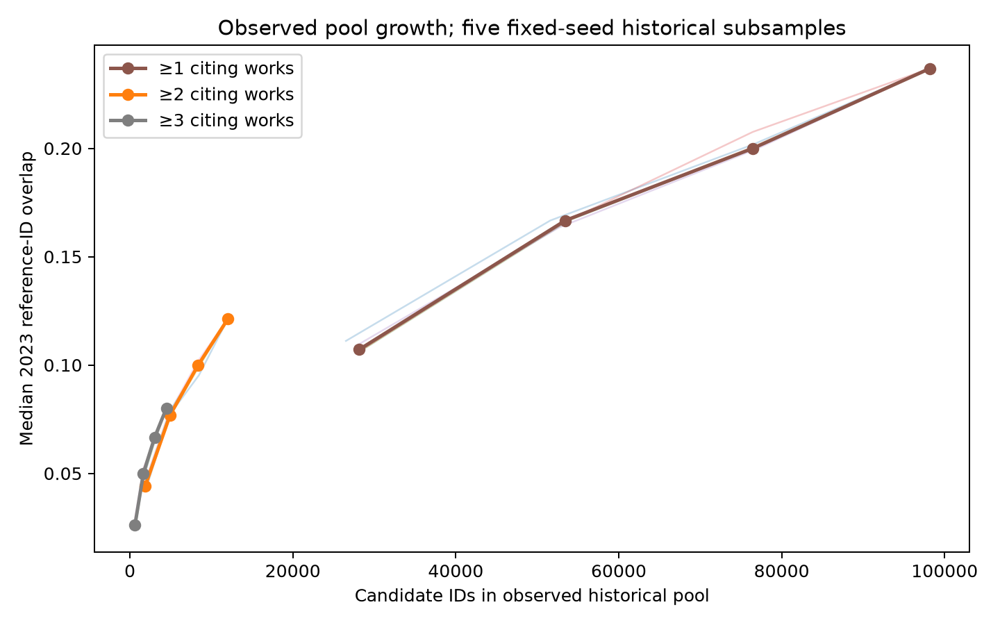

# Phase 5 — Historical candidate-pool reassessment

This is a bounded follow-up to the [first feasibility audit](PHASE5_FEASIBILITY_REPORT.md), not a new population estimate or a recommender evaluation. Inputs are the verified 12,000-work Phase 3 sample and its 289,110 unique directed reference edges. The immutable, Git-ignored measurement run is `data/analysis/phase5_reassessment_20261028_v1/`; its manifest records source/output SHA-256 values. The prior Phase 5 audit still verifies 25/25 output artifacts.

Provenance SHA-256: Phase 3 manifest `5d21e6187f0cf569b284ea399ffff02cb02d29d1e936a5fa716c7c96758de19c`; `works.parquet` `9318c456d916b8c9a35b0a3c86a829a92347083357693593e743abb0253264d4`; `references.parquet` `1c0f306225e6f7fd673b2972744c702d184b2e8f5c88e09569eea24d831d599d`. The published saturation figure has the same SHA-256 as the verified local output: `9d9546b33c2e97e5c9f933e2d53101ea6f39299a33fc75b76741b7f96e750a4a`.

## Cutoff and estimand

For a 2023 query, candidate frequency uses only references contributed by sampled works dated 2020–2022. The 2023 query's own references never contribute to pool membership or popularity. A citing work can contribute edges even if it has no usable abstract or fewer than ten references. Evaluation queries still follow the original title, abstract, date, and ≥10-reference eligibility rule. Every coverage figure here is *reference-ID overlap* within the observed sample; it is neither temporally certified coverage nor retrieval Recall@K. Missing reference lists do not imply no citations.

| Pool construction | Historical citing works | Distinct historical edges | Minimum citers | Candidate IDs | 2023 queries | Mean overlap | Median overlap | P10 / P25 / P75 / P90 | Zero overlap |
|---|---:|---:|---:|---:|---:|---:|---:|---|---:|
| A: eligible historical queries | 2,372 | 94,511 | ≥1 | 74,980 | 909 | 23.1% | 20.5% | 0.0 / 8.0 / 35.7 / 48.9% | 10.6% |
| A: eligible historical queries | 2,372 | 94,511 | ≥2 | 8,183 | 909 | 13.7% | 10.0% | 0.0 / 2.2 / 21.9 / 33.3% | 23.2% |
| A: eligible historical queries | 2,372 | 94,511 | ≥3 | 2,996 | 909 | 10.6% | 6.4% | 0.0 / 0.0 / 17.1 / 27.3% | 29.3% |
| B: all historical edge-bearing works | 3,444 | 127,802 | ≥1 | 98,201 | 909 | 25.7% | 23.7% | 2.6 / 9.8 / 39.1 / 52.2% | 8.9% |
| B: all historical edge-bearing works | 3,444 | 127,802 | ≥2 | 12,019 | 909 | 15.9% | 12.1% | 0.0 / 3.3 / 25.0 / 37.5% | 19.0% |
| B: all historical edge-bearing works | 3,444 | 127,802 | ≥3 | 4,470 | 909 | 12.2% | 8.0% | 0.0 / 0.0 / 20.0 / 30.8% | 26.6% |

At ≥2, the expanded pool raises the median by **2.1 percentage points** (10.0% → 12.1%) and reduces zero-overlap queries by 4.2 points. It contains 6,347 of 37,980 observed 2023 reference edges versus 5,442 in the original pool. At ≥1, median overlap rises by 3.2 points (20.5% → 23.7%). These improvements are real but modest relative to the provisional 40% benchmark; the benchmark is not treated as a scientific law.

At ≥2, 2023 expanded-pool median overlap is 11.97% for articles (854 queries), 15.23% for preprints (44), and 8.33% for reviews (11). By primary subfield it is 9.16% in 1702 (520) and 16.67% in 1707 (389). Small review and preprint strata make subgroup comparisons especially unstable. `coverage_subgroups_2023.csv` preserves all denominators and zero-overlap rates.

## Later diagnostic years — separate historical cutoffs

These are not a 2020–2022 fixed-pool comparison. The 2024 pool uses all 2020–2023 edge-bearing works; the 2025 pool uses 2020–2024. Each evaluation year is held out from its own pool.

| Evaluation year | Historical cutoff | Eligible queries | Expanded pool ≥1: IDs / median | Expanded pool ≥2: IDs / median | Expanded pool ≥3: IDs / median |
|---:|---:|---:|---:|---:|---:|
| 2023 | 2022 | 909 | 98,201 / 23.7% | 12,019 / 12.1% | 4,470 / 8.0% |
| 2024 | 2023 | 963 | 132,869 / 25.2% | 17,840 / 14.3% | 6,767 / 9.1% |
| 2025 | 2024 | 897 | 170,010 / 25.0% | 24,211 / 14.3% | 9,407 / 10.2% |

The later-year figures are diagnostic only: OpenAlex was queried retrospectively and the dataset is a fixed-seed sample, not a historical API snapshot.

## Observed pool growth, not an extrapolation

Five fixed seeds produced nested 25%, 50%, 75%, and 100% subsets of the 3,444 historical edge-bearing works. At the ≥2 threshold:

| Historical fraction | Median pool IDs across seeds | Median 2023 overlap across seeds | Range across seeds |
|---:|---:|---:|---:|
| 25% | 1,886 | 4.4% | 4.2–4.8% |
| 50% | 4,927 | 7.7% | 7.7–7.9% |
| 75% | 8,380 | 10.0% | 9.5–10.2% |
| 100% | 12,019 | 12.1% | 12.1–12.1% |

Overlap still grows over the observed range; this experiment does **not** show a true saturation plateau. Its incremental gain narrows in the latter observed fractions, but extrapolating to a much larger crawl would be unjustified. No extra historical citing-work collection was started: the entire allowed existing historical sample already contributed edges, and a new crawl would need a pre-registered yield/cost target rather than a guess based on this curve.

## Metadata enrichment and temporal validity

The [separate enrichment run](PHASE5_RETRIEVAL_DIAGNOSTIC.md) attempted 1,000 IDs selected solely from 2020–2022 historical frequencies (900 most frequent; 100 seeded frequency-one audit IDs). It returned 973 records and preserved 27 HTTP 404 bodies. The read-only verifier passed 1,000/1,000 raw response hashes. Of 973 returned records, 972 have valid exact publication dates (99.9%); one lacks a date. This selected subset covers 2,777/37,980 observed 2023 reference edges by ID, including 2,670 earlier-year, 38 same-year nonfuture, 64 future-dated and five unknown-date overlaps. Conservative earlier-year overlap is 7.03% of all observed reference edges; exact-date nonfuture overlap is 7.13%. A same-year recorded date does not prove the paper was discoverable when its citing paper was written.

The enriched subset is nonrandom and cannot establish full-pool temporal coverage by extrapolation. Within the full expanded ≥2 pool, 3,578 of its 6,347 overlapping edges still lack enrichment metadata. Downloading metadata cannot add IDs that the historical pool lacks. The previous 2023 median overlap of 10.0% (Strategy A) versus the expanded 12.1% (Strategy B) remains an **ID-level** comparison; the 7.13% exact-date figure uses a much smaller metadata subset and a different denominator/aggregation, so it is not a before–after coverage effect.
