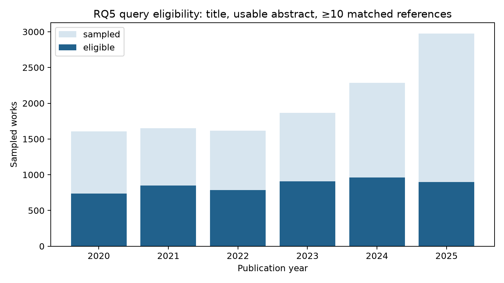
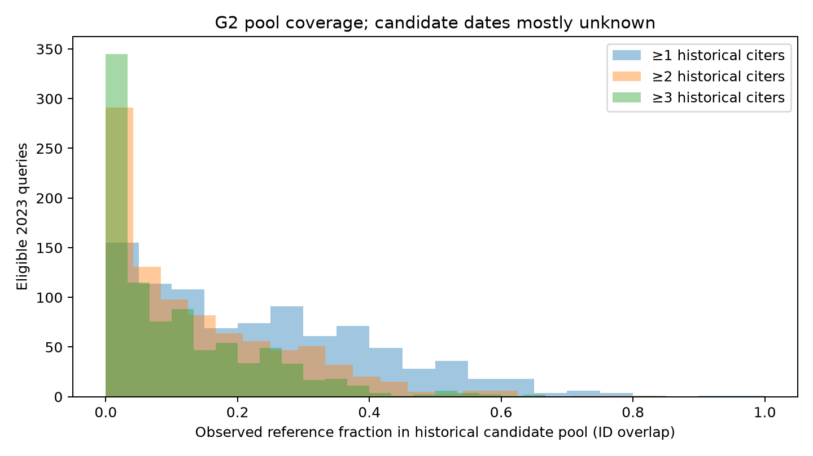

# Phase 5 G1/G2 literature-discovery feasibility audit

Decision: **REVISE** for a supervised citation-aware recommender using only the current local candidate pool.

## Inputs and definitions

Read-only verified Phase 3 input: `data/processed/openalex_stratified/stratified_20261019T155909Z`. Exact table sizes: 12,000 sampled works,
289,110 unique directed reference edges, 4,790 category memberships.
Source checksums:
- `data/processed/openalex_stratified/stratified_20261019T155909Z/works.parquet` — SHA-256 `9318c456d916b8c9a35b0a3c86a829a92347083357693593e743abb0253264d4`
- `data/processed/openalex_stratified/stratified_20261019T155909Z/references.parquet` — SHA-256 `1c0f306225e6f7fd673b2972744c702d184b2e8f5c88e09569eea24d831d599d`
- `data/processed/openalex_stratified/stratified_20261019T155909Z/category_membership.parquet` — SHA-256 `438bf85a8858f135099e198ea552e93da59008f5677cc828694f9ee48ef50ae1`

The approved OpenAlex population aggregates are **not** this downloaded candidate pool.
A query requires a nonblank title, an abstract of at least 50 characters and eight words,
at least ten matched canonical references, and a valid 2020–2025 publication date consistent
with its year. This operational text threshold is exploratory, not a semantic quality judgment.
`reference_list_status=empty` is distinct from `missing`; an empty OpenAlex list does not prove
the paper cites nothing. Reference edges are unique by citing/referenced Work ID.

## G1 — query eligibility

| Year | Sample n | Valid title | Usable abstract | Recorded list | ≥5 refs | ≥10 refs | ≥15 refs | Eligible | Eligible % |
|---:|---:|---:|---:|---:|---:|---:|---:|---:|---:|
| 2020 | 1,607 | 1,607 | 1,115 | 1,080 | 1,011 | 936 | 863 | 738 | 45.9% |
| 2021 | 1,650 | 1,650 | 1,241 | 1,222 | 1,162 | 1,091 | 1,002 | 850 | 51.5% |
| 2022 | 1,615 | 1,614 | 1,271 | 1,142 | 1,102 | 1,042 | 963 | 784 | 48.5% |
| 2023 | 1,865 | 1,864 | 1,510 | 1,280 | 1,237 | 1,158 | 1,076 | 909 | 48.7% |
| 2024 | 2,287 | 2,287 | 1,858 | 1,396 | 1,347 | 1,275 | 1,200 | 963 | 42.1% |
| 2025 | 2,976 | 2,976 | 2,343 | 1,409 | 1,354 | 1,301 | 1,219 | 897 | 30.1% |

| Work type | Sample n | Usable abstract | Recorded list | Eligible | Eligible % |
|---|---:|---:|---:|---:|---:|
| article | 9,265 | 6,966 | 6,703 | 4,549 | 49.1% |
| preprint | 2,678 | 2,319 | 782 | 551 | 20.6% |
| review | 57 | 53 | 44 | 41 | 71.9% |

| Primary subfield | Sample n | Eligible | Eligible % |
|---|---:|---:|---:|
| 1702 | 7,615 | 3,158 | 41.5% |
| 1707 | 4,385 | 1,983 | 45.2% |

Overall eligible: 5,141/12,000
(42.8%). Threshold sensitivity:
≥5 references 5,484, ≥10 5,141,
≥15 4,735 works. Present lists:
7,529; empty lists:
4,471; missing lists:
0.
Missing/short abstracts: 2,662; missing titles:
2; date inconsistencies:
0. Denominators are sampled works, not population works.

## G2 — 2023 historical pool coverage

Historical eligible citing queries: 2020–2022 only. Candidate IDs come from their observed
reference lists; frequency is the number of **distinct** historical citing queries.
Evaluation queries are eligible 2023 works; they never contribute to pool frequencies.
The table is **ID-level pool overlap**, not candidate-generation recall. No text retriever
or reranker was evaluated. Most candidate publication dates are unavailable locally;
therefore these figures are not fully time-valid coverage estimates. Known future-dated
candidates are flagged separately, not assumed valid. Unknown dates cannot be certified.

| Min historical citers | Pool IDs | 2023 queries | Mean | Median | P10 | P25 | P75 | P90 | Zero coverage |
|---:|---:|---:|---:|---:|---:|---:|---:|---:|---:|
| ≥1 | 74,980 | 909 | 23.1% | 20.5% | 0.0% | 8.0% | 35.7% | 48.9% | 10.6% |
| ≥2 | 8,183 | 909 | 13.7% | 10.0% | 0.0% | 2.2% | 21.9% | 33.3% | 23.2% |
| ≥3 | 2,996 | 909 | 10.6% | 6.4% | 0.0% | 0.0% | 17.1% | 27.3% | 29.3% |

At the preselected ≥2 setting, 5,442 of
37,980 observed 2023 reference edges overlap the pool;
0 overlapping edges have known post-query dates and
5,432 have **unknown** candidate dates. The 2023 median
overlap of 10.0% is below the provisional 40% gate. Even relaxing to
≥1 historical citer yields median 20.5%. The frequency ≥3 pool
falls to median 6.4%. See `coverage_summary.csv` for year,
work-type and primary-subfield breakdowns and `historical_fraction_sensitivity.csv`
for nested 25/50/75/100% historical-query subsamples. Increasing the historical
fraction changes measured overlap, but extrapolation beyond these data is not guaranteed.

Coverage by evaluation year for the same fixed 2020–2022 ≥2-citer pool:

| Year | Eligible queries | Mean ID overlap | Median ID overlap | Zero coverage |
|---:|---:|---:|---:|---:|
| 2023 | 909 | 13.7% | 10.0% | 23.2% |
| 2024 | 963 | 12.9% | 9.1% | 21.5% |
| 2025 | 897 | 11.1% | 7.7% | 22.7% |

2023 subgroup checks (primary subfield and work type are separate groupings):

| Primary subfield | Queries | Mean ID overlap | Median ID overlap | Zero coverage |
|---|---:|---:|---:|---:|
| 1702 | 520 | 11.2% | 7.7% | 28.8% |
| 1707 | 389 | 17.1% | 14.0% | 15.7% |

| Work type | Queries | Mean ID overlap | Median ID overlap | Zero coverage |
|---|---:|---:|---:|---:|
| article | 854 | 13.7% | 9.7% | 23.7% |
| preprint | 44 | 16.3% | 12.9% | 13.6% |
| review | 11 | 7.1% | 2.5% | 27.3% |

Selected overlapping OpenAlex-native research-category memberships among 2023
eligible queries (these rows cannot be summed):

| Native category | Member queries | Mean ID overlap | Median ID overlap | Zero coverage |
|---|---:|---:|---:|---:|
| computer vision | 180 | 23.7% | 22.6% | 8.3% |
| explainable ai | 13 | 15.3% | 9.5% | 0.0% |
| multimodal machine learning applications | 20 | 28.2% | 24.1% | 10.0% |
| natural language processing | 61 | 14.3% | 11.1% | 21.3% |
| reinforcement learning | 22 | 14.6% | 11.0% | 4.5% |

Nested historical-query fraction sensitivity at ≥2 citers (seeded Work-ID order):

| Historical fraction | Citing queries | Pool IDs | 2023 median ID overlap |
|---:|---:|---:|---:|
| 25% | 593 | 1,363 | 3.9% |
| 50% | 1,186 | 3,227 | 6.1% |
| 75% | 1,779 | 5,650 | 8.3% |
| 100% | 2,372 | 8,183 | 10.0% |

Known post-query candidates are excluded from the separate
`screened_overlap_coverage` measure, but unknown dates remain uncertified. Even
screened overlap is **not** a fully time-valid coverage estimate.

## Decision and next smallest experiment

**REVISE.** G1 has usable queries, but G2 is the bottleneck. Do not train or claim
a supervised literature recommender yet: low pool overlap caps end-to-end recall,
and candidate publication metadata is missing for most reference IDs. First run a
small, separate expansion experiment with additional **historical citing works**
(not a blind 20,000–30,000-paper crawl), measuring incremental 2023 coverage at
frequency thresholds 1/2/3. Independently enrich publication dates for a targeted
candidate subset to establish temporal validity. Reassess feasibility before modeling.
Neither the observed fixed-seed sample nor nominal year weights establish known
probability sampling. Missing references are not evidence of no citations.
