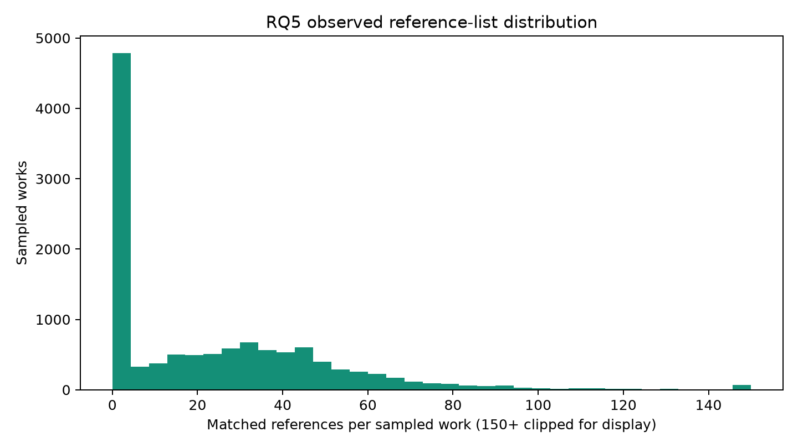
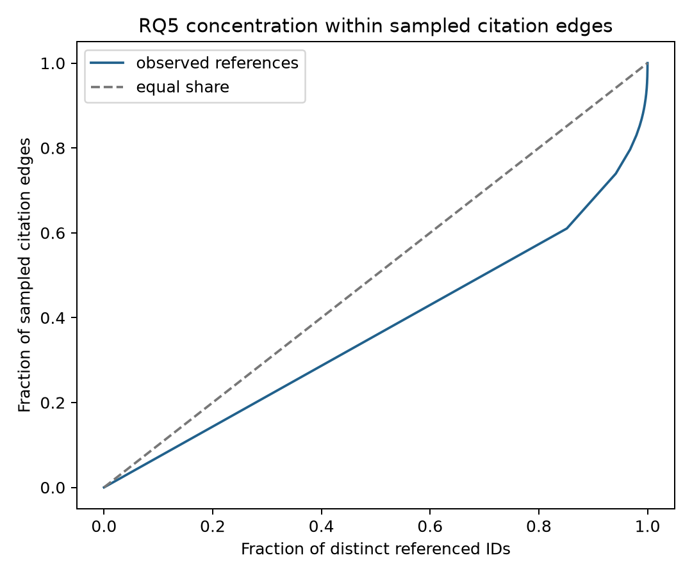

# RQ5 — What prior literature does sampled AI/CV research build on?

This is an **exploratory Phase 5 extension** to RQ1–RQ4. It describes reference
frequencies within 12,000 sampled citing works, not all OpenAlex works,
global citation counts, scientific quality or mandatory citations. The fixed-seed
sample is not a verified probability sample.

## Reference availability

289,110 unique edges point to 207,102
distinct referenced Work IDs. The sample has
7,529 recorded nonempty lists,
4,471 recorded empty lists, and
0 missing lists.
`reference_distribution_by_year.csv`, `reference_distribution_by_type.csv`,
`reference_distribution_by_subfield.csv` and `reference_availability_native_categories.csv`
give denominators and missingness. Native category memberships overlap; they are not
exclusive subareas. List absence is not proof that a work cites nothing.

## Observed citation concentration

Gini coefficient of distinct sampled citing-work frequencies:
0.264. The top 1% and 5% of
referenced IDs account for 12.8%
and 24.3% of observed
edges, respectively. This is within-sample concentration, not global influence.

## Reference age and metadata coverage

Only 727/289,110 observed edges have a
referenced work also present in the 12,000-work sample and thus a locally verified
publication date. 288,383 edges lack local candidate
date metadata; 13 matched edges are future-dated relative
to their citing paper and are excluded from age summaries. For the
714 non-future matched edges only, median age is
1.74 years and 98.3%
are at most five years old. These are a highly selected matched-in-sample subset,
**not** an estimate of reference age in the full citation graph. `reference_age_known.csv`
and `reference_age_by_subfield.csv` preserve the restricted denominator. No dates
were invented for external referenced IDs.

| Citing primary subfield | Known-date edges | Non-future edges | Median age (years) | Within five years |
|---|---:|---:|---:|---:|
| 1702 | 437 | 427 | 1.69 | 98.8% |
| 1707 | 290 | 287 | 1.84 | 97.6% |

These subfield differences are **not** generalizable because date coverage is
tiny and selected by whether the cited work also appears in the sample.

## Primary-subfield core lists

`top_references_by_subfield.csv` ranks each primary subfield's top 20 referenced IDs
by distinct supporting sampled citing works. Titles appear only when a referenced
work is itself in the local sample. Top-list overlap: 1702 vs 1707: 8/32 (Jaccard 0.250). This is a
descriptive signal of shared versus specialized observed reference lists, not a
research-quality ranking. Most cited IDs lack local title/age metadata; no external
metadata were fetched in this pilot.

| Citing primary subfield | Rank | Referenced Work ID | Distinct sampled citing works |
|---|---:|---|---:|
| 1702 | 1 | https://openalex.org/W2194775991 | 251 |
| 1702 | 2 | https://openalex.org/W2626778328 | 152 |
| 1702 | 3 | https://openalex.org/W2963341956 | 127 |
| 1702 | 4 | https://openalex.org/W1522301498 | 116 |
| 1702 | 5 | https://openalex.org/W2896457183 | 111 |
| 1707 | 1 | https://openalex.org/W2194775991 | 516 |
| 1707 | 2 | https://openalex.org/W1901129140 | 261 |
| 1707 | 3 | https://openalex.org/W639708223 | 223 |
| 1707 | 4 | https://openalex.org/W1686810756 | 191 |
| 1707 | 5 | https://openalex.org/W2163605009 | 179 |

## Coverage and inference limits

The ≥2-citer historical candidate pool has 8,183 IDs, and its
eligible 2023 query median **ID-level** reference overlap is 10.0%.
Pool overlap is the ceiling for a retriever that can only rank those IDs;
candidate-generation recall has **not** been measured. A fixed-seed sample of
citing works, incomplete references, unknown candidate dates and possible OpenAlex
metadata updates limit inference. See the [G1/G2 feasibility report](PHASE5_FEASIBILITY_REPORT.md).
