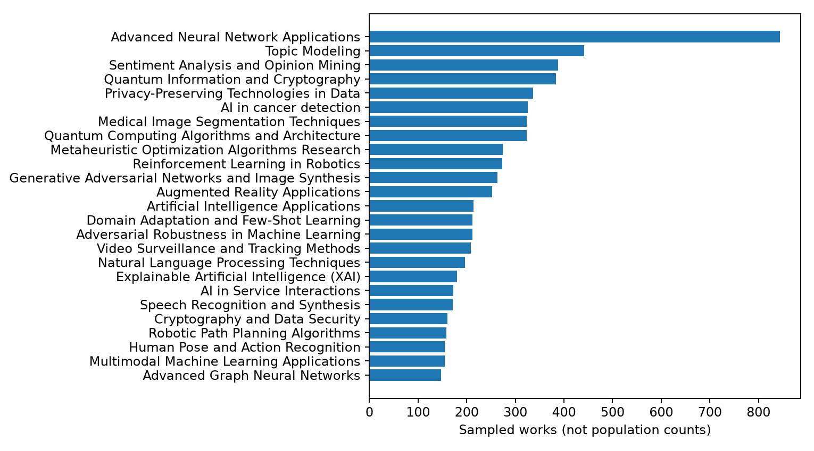

# Phase 6A — OpenAlex primary-topic classification feasibility

## Executive decision: **REVISE**

The verified 12,000-work AI/CV sample supports a real but **narrow** supervised text-classification diagnostic. Five semantically reviewed topics meet the predeclared 120 training / 30 validation support rule, short of the planned 8–15-topic catalogue. On those five labels, 2024 validation agreement with OpenAlex is high (Logistic Regression macro-F1 **0.849**, Linear SVM **0.953**), but these are **silver-label agreement**, not accuracy against independently validated research topics. The five-topic catalogue covers only **20.2%** of 2024 text-eligible works, and the basic open-set rejection diagnostic is weak. Do not present this as a broad user-facing AI/CV topic classifier yet.

## 1. Verified dataset and label audit

Input: unchanged Phase 3 `works.parquet` and `work_topics.parquet` in `data/processed/openalex_stratified/stratified_20261019T155909Z/`. Their SHA-256 values are `9318c456d916b8c9a35b0a3c86a829a92347083357693593e743abb0253264d4` and `e65356b899f3c9dec4d9d47ec9dae54557b23dc1709a1b3ea1d4c5f746acf6d5`; the completed source manifest hash is `5d21e6187f0cf569b284ea399ffff02cb02d29d1e936a5fa716c7c96758de19c`. The read-only Phase 3 validator passed 29 checks across all eight tables. No source table was changed or OpenAlex works recollected.

There are **12,000** unique works and **36,000** work-topic relationships. Every work has a primary topic; all 12,000 `works.primary_topic_id` values match the rank-1 `work_topics.topic_id`. **9,440** works have both nonblank title and abstract; 2,560 fail that text criterion. DOI/normalized-title grouping finds **10** multi-work version groups, **9** later rows excluded after earliest-version retention, and **0** groups with conflicting primary labels in this sample. Thus **9,431** rows are text-eligible and version-isolated. This exact-key grouping may miss near-duplicate versions with changed titles and no shared DOI. No unrestricted all-pairs search was attempted. The full sample has **106** primary topic IDs; all have per-topic support, year, work-type, language and score audits in the Git-ignored run directory. Topic descriptions are preserved where verified; most are unavailable in Phase 3. Works with non-English or missing OpenAlex language tags were retained if text was present; cross-language performance was not independently established. OpenAlex scores are classifier outputs, not calibrated probabilities or a measure of paper quality.

*Figure 1. Top primary topics in the 12,000-work detailed sample; these bars are **not** full-population topic counts.*

## 2. Predeclared catalogue and support

The [primary selection protocol](../docs/PHASE6_TOPIC_SELECTION_PROTOCOL.md) was written before model fitting. Its five-class non-confirmatory contingency was added after a preliminary training/validation support inspection but before model fitting; it is **not** represented as a fully preregistered primary analysis. Semantic scope decisions use topic names, descriptions and subfields; support uses only 2020–2023 training and 2024 validation after text/version filtering. Neither 2025 label frequencies nor model performance selected topics. The [five-topic description catalogue](../config/phase6_topic_catalogue.yaml) records official OpenAlex URLs and was assembled from prior verified discovery evidence plus two bounded singleton topic lookups on 2026-10-28. Independent scope review is **pending**, particularly for the broad T10036 and medically specific T10052.

| Primary topic | Scope rationale | Train 2020–23 | Validation 2024 |
|---|---|---:|---:|
| T10036 Advanced Neural Network Applications | CV deep-learning methods; broad | 369 | 146 |
| T10664 Sentiment Analysis and Opinion Mining | NLP task | 190 | 58 |
| T10028 Topic Modeling | NLP methods; broad OpenAlex description | 149 | 85 |
| T10052 Medical Image Segmentation Techniques | CV segmentation method in a medical setting | 127 | 45 |
| T10462 Reinforcement Learning in Robotics | RL methods, robotics-specific | 120 | 45 |

Of the 106 observed primary topics, only **9** meet numerical support; the provisional semantic pass retains five, explicitly excludes two quantum/cryptography topics, and leaves **99** for manual scope review. T10764 privacy and T10862 AI in cancer detection are notable supported-but-unresolved cases; they are not automatically forced into the task. The pilot has **955** in-catalogue training rows and **379** validation rows; **1,494** of the 1,873 text-eligible 2024 works are outside the catalogue. Coverage is **18.4%** of training-eligible and **20.2%** of validation-eligible works. The predeclared 8–15-topic target **fails**. The five-class experiment is a labeled non-confirmatory contingency, not a retroactively expanded catalogue. The dedicated 2025 split contains **2,373** sealed eligible IDs/version groups and no model features or predictions. The all-topic descriptive audit separately contains observed 2025 source-label counts because it inventories the 2020–2025 sample; those counts were **not used for selection**, tuning, or this decision. No 2025 model metric or prediction error was calculated.

## 3. 2024 model experiment (same 379 papers for all methods)

Input features are title plus reconstructed abstract only. Unicode normalization and whitespace cleanup preserve technical text. The training-only TF-IDF vocabulary has **24,559** features; validation is transform-only. No source, citation, topic ID/score, publication year, author or institution metadata enters predictive features. The majority baseline uses training support. Description matching uses only the five verified topic descriptions and a separate TF-IDF cosine representation, without learning from paper labels. Model settings are fixed in the protocol; no 2025 tuning occurred.

| Model | Accuracy | Macro-F1 | Weighted-F1 | Status |
|---|---:|---:|---:|---|
| Majority class | 0.385 | 0.111 | 0.214 | measured |
| OpenAlex description matching | 0.631 | 0.579 | 0.629 | measured; zero-training baseline |
| TF-IDF + Logistic Regression | **0.860** | **0.849** | **0.856** | prespecified supervised pilot |
| TF-IDF + Complement Naive Bayes | 0.834 | 0.827 | 0.829 | optional comparison |
| TF-IDF + Linear SVM | 0.950 | 0.953 | 0.950 | optional comparison; not independently validated |

Logistic macro-F1 exceeds the strongest baseline by **0.270**; paired paper-bootstrap 95% interval for the difference is **[0.199, 0.329]** (200 fixed-seed draws). Its own bootstrap 95% interval is **[0.809, 0.887]** for macro-F1 and **[0.826, 0.897]** for accuracy. In this split each retained version group has one work, so paper resampling is group resampling. These intervals describe variation within this sampled validation set, not generalization to all global AI/CV or uncertainty in OpenAlex labels. Exact fit times and all metrics are in the local run manifest; times are hardware-dependent.

On this machine, training-only TF-IDF fitting and validation transformation together took **0.725 s**, Logistic Regression fitting **4.56 s**, Complement NB **0.029 s**, and Linear SVM **0.100 s**. Batched 2024 validation transform plus model prediction measured about **0.304 ms per paper** for Logistic Regression (379 papers); this excludes model loading, text preparation and network/application overhead and is not a production latency benchmark.

### Error and label ambiguity

Logistic Regression's lowest recall is T10052 medical-image segmentation, **25/45 = 55.6%**; 20 of its 45 examples are assigned to broad T10036. T10028 topic modeling has **66/85 = 77.6%** recall, with 13 assigned T10036 and six T10664. T10462 has **36/45 = 80.0%** recall. Aggregate per-class results and confusion counts are published below; Work-ID-level predictions stay local and Git-ignored. On validation, the median OpenAlex rank-1 topic score is **0.944** for correctly classified papers and **0.843** for errors. This association does not calibrate the scores or prove the OpenAlex label is wrong. In the full sample, T10028 frequently co-occurs in the top three with T10181 NLP (rank 2 on 189 works; rank 3 on 91); T10052 co-occurs with T10036 at rank 3 on 72 works. These are actual OpenAlex secondary memberships and signal potentially fuzzy class boundaries, not human adjudication. No conflicting labels were found among the 10 exact-key version groups, but that sample is too small to establish label stability.

Logistic Regression confusion matrix (rows: OpenAlex primary label; columns: model prediction):

| | T10036 | T10664 | T10028 | T10052 | T10462 |
|---|---:|---:|---:|---:|---:|
| **T10036** | 145 | 0 | 1 | 0 | 0 |
| **T10664** | 4 | 54 | 0 | 0 | 0 |
| **T10028** | 13 | 6 | 66 | 0 | 0 |
| **T10052** | 20 | 0 | 0 | 25 | 0 |
| **T10462** | 8 | 0 | 1 | 0 | 36 |

Small aggregate [per-class results](phase6a/per_class.csv), [scope review](phase6a/scope_review.csv) and [complete topic audits](phase6a/topic_summary.csv) are published for reviewers. Record-level predictions, paper text and answer keys remain local and Git-ignored.

### Out-of-catalogue diagnostic

The 2024 open-set comparison uses the 379 in-catalogue validation rows and **1,494** outside-catalogue rows. Maximum Logistic Regression predicted probability has median **0.538** inside and **0.412** outside. At an illustrative, **uncalibrated** threshold 0.5, it would reject **159/379** in-catalogue papers and still confidently force-assign **310/1,494** outside papers. This is not a validated abstention policy; the model was trained only to discriminate five classes. Even an SVM's higher closed-set label agreement cannot solve catalogue coverage by itself.

## 4. Scientific validity and integration

This experiment measures **agreement with OpenAlex's automated primary-topic assignments for a selected five-class, text-complete slice**. It does not establish that the labels are scientifically correct; title and abstract may also be inputs to OpenAlex's own classifier, making high agreement unsurprising. Text-absent works, language variation, topic-model drift and sample-selection uncertainty further limit transportability. The Phase 2 sample's OpenAlex sampling probabilities were not proven, so these class shares are not population estimates. RQ1 population trends remain based on verified OpenAlex aggregates; RQ2 citation context and RQ3 OA associations remain observational; RQ4 collaboration analysis remains part of the academic study. A future classifier could link a research paper to RQ1 topic context and selected RQ5 literature, but must not be presented as a ground-truth or comprehensive finder. A later RQ6 should explicitly study silver-label reliability and taxonomy stability.

The [blind human annotation guidelines](../docs/PHASE6_HUMAN_ANNOTATION_GUIDELINES.md) and 36-paper local calibration template are ready; separate answer key is restricted. **Human label validation pending.** No human agreement statistic is reported. The optional October 2026 upstream taxonomy change-set was not analyzed here; the local snapshot is fixed, and no historical relabeling claim is made.

## 5. Reproducibility, limitations, next action

Final local output: `data/analysis/phase6_topic_pilot_20261028_v11/` (Git-ignored), with manifest, hashed CSVs, support chart, split IDs/text, scope table, confusion matrix, prediction audit, blind sheet and restricted key. Its 2026-10-28 08:23:25 UTC manifest records 16 output hashes; independent v12 rerun matched **16/16**, and all 16 v11 artifact hashes verified. [Eight published aggregate CSVs and provenance hashes](phase6a/README.md) and the published support PNG match their local source hashes. The unchanged Phase 3 validator passed **29/29** checks. Final offline `pytest -q -ra` yielded **137 passed, 1 opt-in live test skipped**; `pip check` reported no broken requirements; the installed `openalex-pilot-topics --help` entry point executed. The source Parquet, Phase 3 manifest and prior analytical outputs remain untouched. Do not publish local training/annotation CSVs: they contain paper text and label-sensitive records.

**Recommendation: REVISE.** Keep the five-class model as a transparent teaching diagnostic, not the main 8–15-topic user-facing claim. The smallest next task is independent semantic review of the 99 unresolved topic names/definitions and a blinded 36-paper human calibration. Then decide prospectively whether a narrower five-topic educational tool is acceptable, whether a scientifically justified regrouping can reach 8–15 topics, or whether to abandon broad classification. Do not run 2025 model evaluation until that decision and a final evaluation protocol are frozen.
