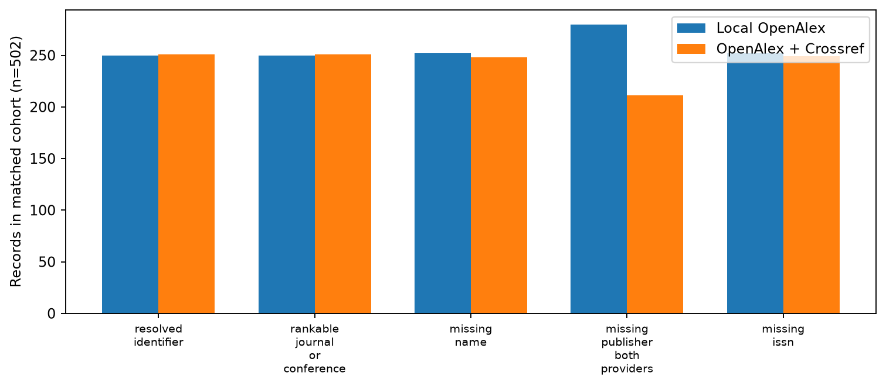
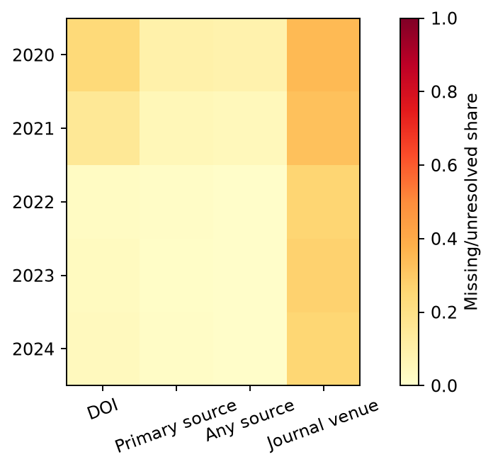
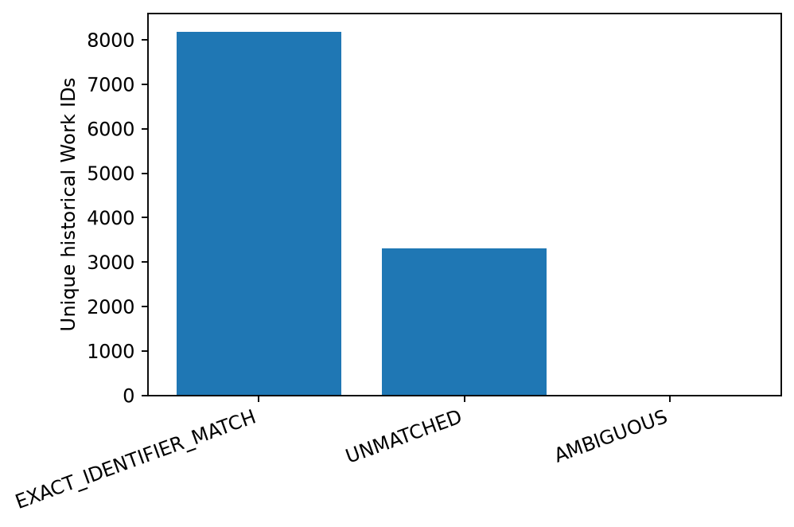
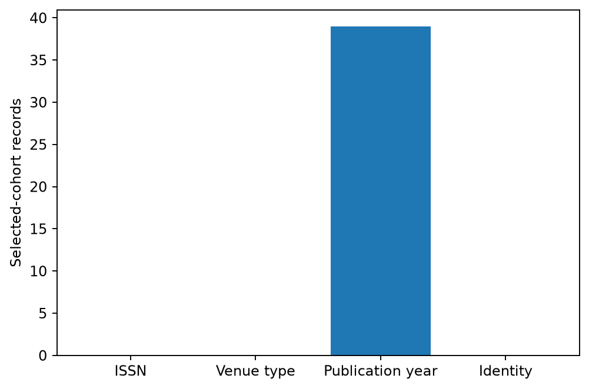
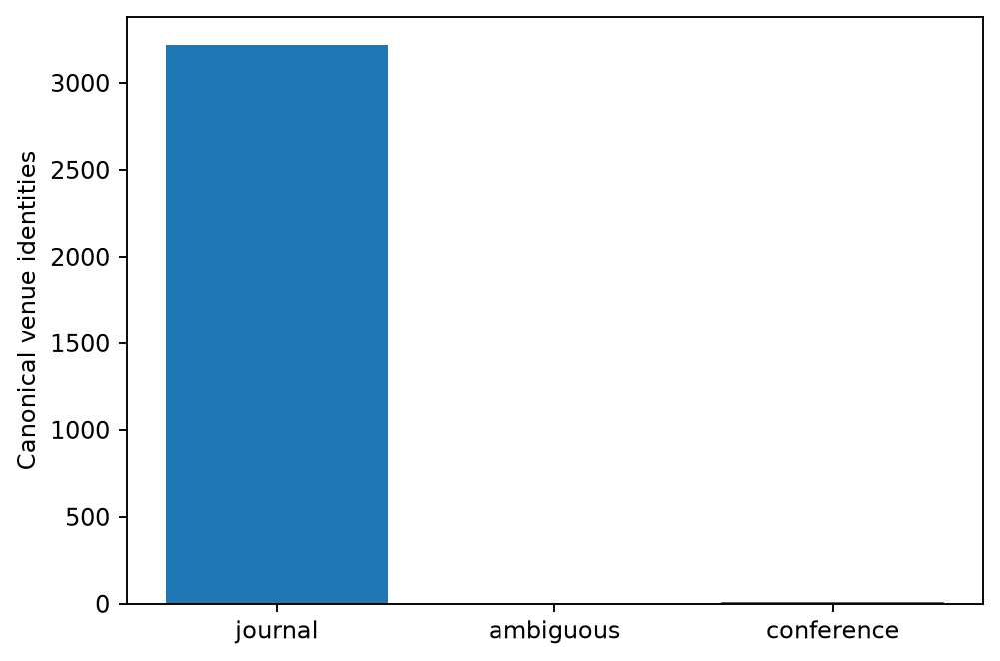
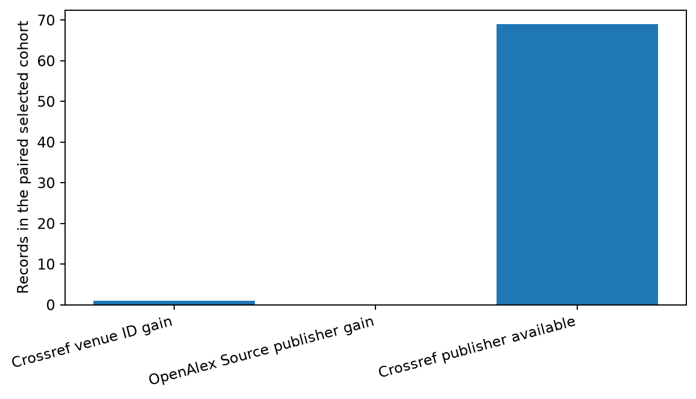
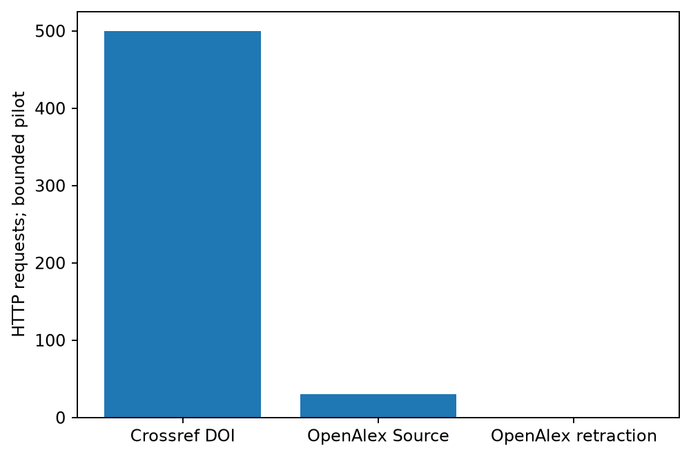

# RQ7 — Multi-Source Metadata Integration

**Question:** Does adding Crossref and bounded OpenAlex Source detail to locally saved OpenAlex works improve venue metadata completeness and identity resolution? The paired cohort is **502 paper records carrying 500 selected distinct DOI values**; two selected DOIs occur on two source records. Selection deliberately balances publication year and local venue missingness, so its yield is not a population rate.

| Metric, same 502-record cohort | Local OpenAlex | Enriched | Change |
|---|---:|---:|---:|
| Stable venue ID | 250 | 251 | +1 |
| Journal/conference ID | 250 | 251 | +1 |
| Missing venue name | 252 | 248 | -4 |
| Missing publisher | 280 | 211 | -69 |
| Missing ISSN | 252 | 249 | -3 |
| Ambiguous/conflicting identity | 0 | 0 | +0 |

Crossref yielded 289 parseable DOI matches; 30 unique OpenAlex Source records were fetched once each. Among selected paper records, OpenAlex Source API detail filled 0 previously missing local publisher fields, while Crossref supplied publisher values for 69 records missing the local value; these sets may overlap, so do not add them. Provider comparison flagged 39 publication-year differences; these may reflect online/print date conventions, not necessarily incorrect metadata. ISSN conflicts: 0; source-type conflicts: 0. The audit retains original and provider-specific values. 33 repeated Work-ID records across origins were deterministically reduced to one paper link while retaining source-record decisions.

The identity gain was **only 1 record**. Missing publisher decreased by 69 records, a meaningful descriptive completeness gain for this intentionally selected cohort. More metadata and provider agreement do **not** prove correctness: no independent publisher/venue human adjudication was completed. Crossref does not independently validate OpenAlex when OpenAlex already ingested similar provider metadata.

Canonical model: `canonical_venues.parquet` has 3,230 stable source/ISSN-backed identities. `paper_venue_links.parquet` has 11,506 unique Work IDs. `venue_conflict_audit.parquet` preserves every source-record/provider decision. Repositories never enter the rankable journal/conference pool. Names are aliases, not sole identity keys.

**Decision: CONDITIONAL GO for metadata enrichment**, chiefly publisher completeness and provenance; **NO-GO for broad DOI-by-DOI Crossref harvesting as a venue-identity rescue strategy** on current evidence.

